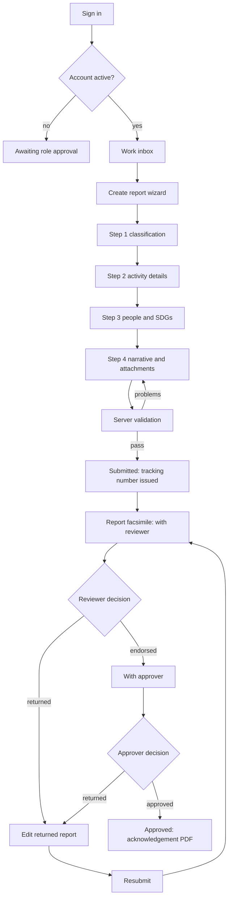
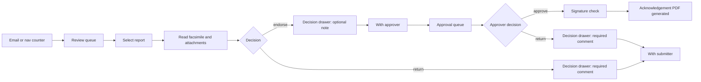
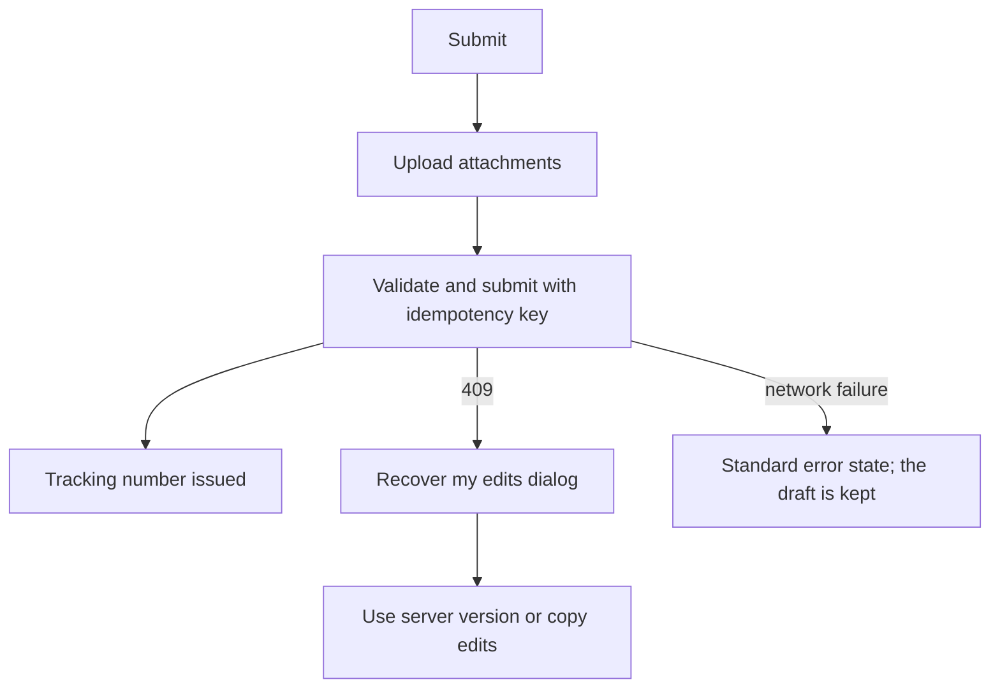
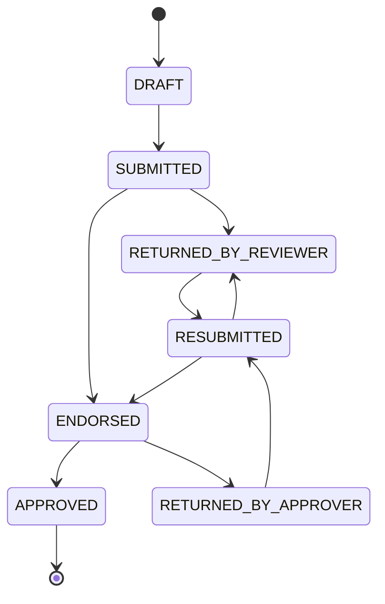

# OVPCASSS Paperless PAR: UI/UX Design Spec

Status: Proposed v0.1
Owner: apps/web (shared by the Tauri shell)
Companions: [`par-paperless-spec.md`](./par-paperless-spec.md),
[`../OVPCASSS-PAPERLESS_PROCESS_FOR_PAR.md`](../OVPCASSS-PAPERLESS_PROCESS_FOR_PAR.md)
Brand asset: [`../OVPCASSS_LOGO.jpg`](../OVPCASSS_LOGO.jpg)
Implementation phases: [`ui/README.md`](./ui/README.md) — this document split into
per-session specs, one runnable phase at a time.

This document decides **what the interface looks like, how it is navigated, and
how each screen behaves**. It is a design contract, not code. Milestone tags
(M1–M7) refer to §13 of the project spec.

---

## 1. Recommended direction in one paragraph

An **institutional civic interface** for a university records system: navy
chrome, white working surfaces, a cream "paper" facsimile, serif document
typography, gold used only as a seal-like accent, and maroon reserved for
returned reports and destructive actions. Navigation is a **navy top bar with
five role-filtered destinations and a second row of section tabs**. The landing
screen is a **role-aware work inbox that leads with what needs the user's
action**. Work is **compact and table-first**; the report itself is presented as
a **document facsimile** with a print-preview mode. Decisions (endorse, approve,
return) happen in a **right-side drawer** over the report, so the reviewer never
loses the document. On wide monitors, lists become **master–detail**; on the
1366×768 laptops the office actually uses, rows open a full page.

The system should feel like _the paper process, done properly_ — not like a
generic SaaS tool and not like a literal scan of a form.

---

## 2. Why this direction (and what was rejected)

| Decision                                        | Chosen because                                                                                                                                        | Rejected alternatives                                                                                                                                                |
| ----------------------------------------------- | ----------------------------------------------------------------------------------------------------------------------------------------------------- | -------------------------------------------------------------------------------------------------------------------------------------------------------------------- |
| Navy top bar + section tabs                     | Matches the "official university system" register; five destinations fit a 1366 px laptop; tabs absorb sub-pages without a sidebar eating table width | Left sidebar (crowds 1024–1280 px), dashboard-tile hub (adds a screen nobody needs), icon rail (hides labels from occasional users)                                  |
| Role-aware work inbox                           | Every role starts with a to-do list, so the system tells people what to do instead of making them hunt                                                | "Always My reports" (reviewers land on an empty screen), counters-only dashboard (pretty but not actionable)                                                         |
| Four-step wizard to create, single page to edit | First submission is high-anxiety and field-heavy; corrections are targeted and should not force a wizard march                                        | Single long form (overwhelming first run), wizard for edits (hostile when fixing two fields), two-step form (too dense)                                              |
| Document facsimile + record mode                | The office thinks in terms of "the PAR"; reviewers need to read it like the paper form, but workflow needs a scannable screen                         | Paper-faithful only (poor for comments/actions), plain record only (loses institutional identity)                                                                    |
| Master–detail at ≥1440 px                       | Fast triage on the office's large monitors without compromising laptops                                                                               | Split everywhere (cramped at 1366), never split (extra clicks per report), summary-only pane (duplicates the page)                                                   |
| Decision drawer                                 | Keeps the facsimile and attachments visible while the reviewer writes a return comment                                                                | Dedicated review screen (duplicate detail page), inline action bar (pushes content, weak for comment drafting), confirm-only dialogs (no room for required comments) |
| shadcn-svelte on Tailwind 4                     | Owned components, accessible primitives, consistent with the existing Tailwind setup; no opaque library styling                                       | Bits UI bare (too much design work), Skeleton/Flowbite (library look, harder to brand), hand-rolled (maintenance)                                                    |
| Compact, table-first                            | Office users triage dozens of rows; search and exports are tabular by nature                                                                          | Card-first (fewer items, more scrolling), density toggle (extra state to build and test)                                                                             |
| Official form terminology                       | Matches the paper process, exports, and the audit vocabulary; avoids a translation layer in training                                                  | Plain-language labels (nice for novices, wrong for the official record)                                                                                              |
| Light + system dark                             | Modern default without a separate theme project; office printing and the facsimile stay light                                                         | Light only (misses a cheap preference win), dark-first (fights document reading)                                                                                     |

---

## 3. Design principles

1. **The report is the hero.** Every screen either gets the user to a report,
   moves a report forward, or finds a stored report.
2. **Action before information.** Where a user has agency, it appears above
   context: "Returned to you (2)" precedes "Recent activity".
3. **Status is never color alone.** Every status carries a label and an icon or
   shape; maroon and green are reinforcement, not the message.
4. **Compact, not cramped.** 40 px rows, 13 px table type, generous horizontal
   padding; density comes from structure, not from shrinking hit targets.
5. **Paper where it matters.** The facsimile earns its serif type, cream stock,
   and ruled sections; the chrome around it stays a modern application.
6. **One screen, one primary action.** Each page has exactly one filled navy
   button; everything else is outline, ghost, or in the row menu.
7. **No dead ends.** Empty, failed, denied, and error states always name the
   next action and link to it.
8. **Keyboard is a shortcut, never a requirement.** Every shortcut has a visible
   mouse path.

---

## 4. Visual identity and tokens

### 4.1 Palette

Derived from `docs/OVPCASSS_LOGO.jpg` (maroon, amber-gold, navy on white),
with **navy as the primary**. Values are starting tokens; confirm against the
official brand guide before M1 ships.

| Token                | Hex (light) | Role                                                 |
| -------------------- | ----------- | ---------------------------------------------------- |
| `--brand-navy-900`   | `#0B1733`   | Top bar, headings, darkest text                      |
| `--brand-navy-800`   | `#152452`   | Primary buttons, active tab, links                   |
| `--brand-navy-700`   | `#1E3372`   | Hover on primary, focus ring                         |
| `--brand-navy-100`   | `#E7EBF5`   | Selected rows, subtle navy fills                     |
| `--brand-gold-600`   | `#B8862B`   | Accent rules, active underline, letterhead seal line |
| `--brand-gold-400`   | `#D9AE5F`   | Endorsed status, decorative only                     |
| `--brand-gold-100`   | `#F7EFDC`   | Endorsed badge background                            |
| `--brand-maroon-800` | `#7A1F1F`   | Returned status, destructive/return actions          |
| `--brand-maroon-100` | `#F5E6E6`   | Returned badge background                            |
| `--surface-cream`    | `#FBF8F2`   | Facsimile paper, print preview                       |
| `--surface-page`     | `#F6F7F9`   | App background                                       |
| `--surface-card`     | `#FFFFFF`   | Cards, tables, forms                                 |
| `--border`           | `#DDE2EA`   | Default border                                       |
| `--text-primary`     | `#111827`   | Body text                                            |
| `--text-secondary`   | `#5B6472`   | Labels, metadata                                     |
| `--text-disabled`    | `#9AA3B2`   | Disabled controls                                    |
| `--success-700`      | `#166534`   | Approved                                             |
| `--success-100`      | `#DCFCE7`   | Approved badge                                       |
| `--info-700`         | `#1D4ED8`   | Submitted / resubmitted                              |
| `--info-100`         | `#DBEAFE`   | Submitted badge                                      |
| `--warning-700`      | `#92400E`   | Attention, stale queue items                         |

Rules:

- Gold is **never** a button color and never the only signal of state.
- Maroon is **never** used for "delete" alone; it means "sent back" in workflow
  contexts and destructive in menus. The label disambiguates.
- Primary actions are navy; one per screen.

### 4.2 Status mapping

| Status (shared enum)   | Badge label          | Color                                           | Icon/shape       |
| ---------------------- | -------------------- | ----------------------------------------------- | ---------------- |
| `DRAFT`                | Draft                | Neutral slate (`--text-secondary` on `#EEF1F5`) | Pencil           |
| `SUBMITTED`            | Submitted            | Info blue                                       | Inbox            |
| `RESUBMITTED`          | Resubmitted          | Info blue                                       | Inbox with arrow |
| `RETURNED_BY_REVIEWER` | Returned by reviewer | Maroon                                          | U-turn arrow     |
| `RETURNED_BY_APPROVER` | Returned by approver | Maroon                                          | U-turn arrow     |
| `ENDORSED`             | Endorsed             | Gold                                            | Forward arrow    |
| `APPROVED`             | Approved             | Success green                                   | Check            |

Queue and dashboard counts always show the badge label in text; color is a
secondary cue.

### 4.3 Typography

No webfont dependency in v1; keep the system stack so the Tauri build stays
offline-safe.

| Role                                    | Stack                                                | Size / weight                              |
| --------------------------------------- | ---------------------------------------------------- | ------------------------------------------ |
| UI body                                 | `system-ui, -apple-system, "Segoe UI", sans-serif`   | 14 px / 400; tables 13 px                  |
| UI headings                             | Same sans                                            | H1 24/600, H2 18/600, H3 15/600            |
| Labels                                  | Same sans                                            | 12 px / 500, `--text-secondary`            |
| Document (facsimile, print, letterhead) | `Georgia, "Times New Roman", serif`                  | Body 13.5 px / 1.55; document title 20/600 |
| Tracking numbers, dates in tables       | `ui-monospace, "Cascadia Mono", Consolas, monospace` | Tabular numerals                           |

Optional later: Source Serif 4 for document type if licensing is approved. Do
not add it in M0.

### 4.4 Spacing, radius, elevation

- 4 px base scale: 4, 8, 12, 16, 24, 32, 48. Page gutter 24 px.
- Control heights: 32 px default, 28 px compact table actions, 36 px primary.
- Table rows: 40 px; header 36 px; never below 36 px.
- Radius: 6 px cards/controls, 4 px badges, 2 px document rules. No pill shapes
  except count badges (full radius).
- Elevation: one level only (`0 1px 2px rgba(11,23,51,.06)`); drawers use a
  stronger shadow; no floating cards on cards.
- Focus ring: 2 px `--brand-navy-700`, 2 px offset. Visible on every interactive
  element, including table rows.

### 4.5 Dark mode

`prefers-color-scheme: dark` flips semantic tokens; the facsimile stays light
(paper is paper) with a subtle warm border, and print always uses light tokens.

| Token                          | Dark value                             |
| ------------------------------ | -------------------------------------- |
| Page                           | `#0B1220`                              |
| Card                           | `#111A2E`                              |
| Border                         | `#24304A`                              |
| Text primary                   | `#E6EAF2`                              |
| Text secondary                 | `#A7B0C2`                              |
| Primary                        | `#6C8AE4` (navy lifted for contrast)   |
| Info / success / maroon badges | 20% tinted backgrounds, 300-level text |

The top bar stays `#0B1733` in both themes.

### 4.6 Iconography

Lucide via shadcn-svelte defaults, 16 px in tables, 18 px in buttons, 20 px in
nav. Status icons are semantic, not decorative. The university seal appears only
in the header (28 px), auth card (64 px), and print letterhead.

---

## 5. Information architecture

### 5.1 Route → destination map

| Route                                                                         | Destination                    | Roles                        | Nav location           |
| ----------------------------------------------------------------------------- | ------------------------------ | ---------------------------- | ---------------------- |
| `/`                                                                           | Work inbox                     | all signed-in                | Home                   |
| `/reports`                                                                    | My reports (table)             | all                          | Reports → All          |
| `/reports?tab=drafts`                                                         | Drafts                         | all                          | Reports → Drafts       |
| `/reports?tab=returned`                                                       | Returned to me                 | SUBMITTER (others read-only) | Reports → Returned     |
| `/reports/new`                                                                | Create wizard                  | SUBMITTER                    | Reports → + New report |
| `/reports/[id]`                                                               | Report facsimile (record mode) | all with access              | row click              |
| `/reports/[id]?print=1`                                                       | Print preview                  | all with access              | toggle                 |
| `/reports/[id]/edit`                                                          | Edit returned report           | owning SUBMITTER             | Returned row           |
| `/review`                                                                     | Review queue                   | REVIEWER                     | Queues → Review        |
| `/review/[id]`                                                                | Facsimile + review context     | REVIEWER                     | row click              |
| `/approval`                                                                   | Approval queue                 | APPROVER                     | Queues → Approval      |
| `/approval/[id]`                                                              | Facsimile + approval context   | APPROVER                     | row click              |
| `/search`                                                                     | Repository search              | REVIEWER, APPROVER, ADMIN    | Repository → Search    |
| `/exports`                                                                    | Monitoring exports             | REVIEWER, APPROVER, ADMIN    | Repository → Exports   |
| `/notifications`                                                              | In-app inbox (**new route**)   | all                          | bell menu              |
| `/profile`                                                                    | Profile, password, signature   | all (signature: APPROVER)    | avatar menu            |
| `/admin/users`                                                                | Users & roles                  | ADMIN                        | Admin → Users          |
| `/admin/reference-data`                                                       | Reference data                 | ADMIN                        | Admin → Reference data |
| `/admin/audit`                                                                | Audit log                      | ADMIN                        | Admin → Audit          |
| `/login`, `/register`, `/verify-email`, `/forgot-password`, `/reset-password` | Auth                           | public                       | none (auth layout)     |
| `/awaiting-approval`                                                          | Account pending role           | PENDING_ROLE                 | none (status page)     |

Existing scaffold routes are preserved. `/search` is labelled **Repository** in
the UI; `/exports` is a **Repository** tab. This keeps URLs stable while the
labels match how the office talks.

### 5.2 Top navigation

Five destinations, filtered by role. A user with several capabilities sees the
union; a Submitter never sees Queues, Repository, or Admin.

| Nav item   | Submitter | Reviewer | Approver | Admin |
| ---------- | :-------: | :------: | :------: | :---: |
| Home       |     ✓     |    ✓     |    ✓     |   ✓   |
| Reports    |     ✓     |    ✓     |    ✓     |   ✓   |
| Queues     |           |    ✓     |    ✓     |       |
| Repository |           |    ✓     |    ✓     |   ✓   |
| Admin      |           |          |          |   ✓   |

- **Reports** is the submitter's home for work; reviewers/approvers see it as
  their read-only trail of reports they touched.
- **Queues** is a single destination with two tabs (Review, Approval) so the bar
  never grows. A user with both capabilities sees both tabs; a stale tab count of
  zero still renders.
- **Repository** holds Search and Exports; both are retrieval functions.
- Admin does **not** gain review/approve actions by virtue of being Admin
  (project spec §9). Admin sees Repository for all reports.
- Profile is **not** a nav item; it lives in the avatar menu with Sign out.

### 5.3 Shell anatomy

```
┌──────────────────────────────────────────────────────────────────────────────┐
│ [seal] OVPCASSS Paperless PAR   Home  Reports  Queues  Repository  Admin     │ 56 px, navy
│                                              [/ Search]  [bell 3]  [JD ▾]     │
├──────────────────────────────────────────────────────────────────────────────┤
│  Reports    All   Drafts   Returned   Approved              [+ New report]    │ 40 px, white
├──────────────────────────────────────────────────────────────────────────────┤
│                                                                              │
│   page content                                             max-width 1440    │
│                                                                              │
└──────────────────────────────────────────────────────────────────────────────┘
```

- The section-tab row renders only inside a section (Reports, Queues, Repository,
  Admin) and only when there is more than one tab.
- Active nav item: 2 px gold underline plus white text. Active tab: navy text
  plus 2 px navy underline.
- The `/` search affordance is visible to REVIEWER/APPROVER/ADMIN only.
- The bell shows unread count (cap "9+"); its menu links to `/notifications`.
- The avatar menu lists full name + role, Profile, Keyboard shortcuts, Sign out.
- A skip link ("Skip to content") is the first focusable element.
- Below 1024 px: content is replaced by a single centered notice ("This system
  is designed for screens 1024 px and wider"); auth pages are exempt.

---

## 6. Screen inventory at a glance

| #   | Screen                           | Milestone | Primary action           |
| --- | -------------------------------- | --------- | ------------------------ |
| 1   | Sign in                          | M1        | Sign in                  |
| 2   | Register                         | M1        | Create account           |
| 3   | Verify email                     | M1        | Resend verification      |
| 4   | Forgot / reset password          | M1        | Send link / Set password |
| 5   | Awaiting role approval           | M1        | Sign out                 |
| 6   | Work inbox                       | M1        | Resume / Create report   |
| 7   | My reports table                 | M3        | New report               |
| 8   | Create wizard (4 steps)          | M3        | Submit report            |
| 9   | Edit returned report             | M3        | Resubmit                 |
| 10  | Report facsimile (record mode)   | M4        | Role-dependent           |
| 11  | Report facsimile (print preview) | M4        | Print / Download PDF     |
| 12  | Review queue                     | M4        | Endorse / Return         |
| 13  | Approval queue                   | M4        | Approve / Return         |
| 14  | Repository search                | M5        | Open report              |
| 15  | Monitoring exports               | M6        | Download .xlsx           |
| 16  | Notifications inbox              | M5        | Open report              |
| 17  | Profile & signature              | M1 / M4   | Save                     |
| 18  | Admin users                      | M1        | Assign role              |
| 19  | Admin reference data             | M2        | Save entry               |
| 20  | Admin audit log                  | M5        | Inspect event            |
| 21  | Shortcut help sheet              | M5        | —                        |

---

## 7. Page-by-page specification

Layout regions below are named consistently: **top bar**, **tab row**,
**page header** (title, meta, primary action), **content**, **rail**,
**action bar**, **footer**.

### 7.1 Sign in (`/login`)

Roles: public. Layout: auth layout — cream page, centered 400 px white card,
seal 64 px above the title, no app chrome.

```
┌────────────────────────── cream page ───────────────────────────┐
│                          [seal]                                 │
│              OVPCASSS Paperless PAR                              │
│              Sign in to submit and track reports                 │
│   ┌──────────────────────────────────────────────────────┐      │
│   │ University email                                     │      │
│   │ [_______________________________________________]    │      │
│   │ Password                              Forgot?        │      │
│   │ [_______________________________________________]    │      │
│   │ [ Sign in ]                                          │      │
│   │ New here? Create an account                          │      │
│   └──────────────────────────────────────────────────────┘      │
│   Authorized use only. Activity is recorded in the audit log.    │
└──────────────────────────────────────────────────────────────────┘
```

- Email input `autocomplete="username"`, password `current-password`; Enter
  submits.
- Errors: one inline alert above the fields with a uniform message ("Email or
  password is incorrect") plus per-field errors when format is wrong; never
  reveal whether an account exists.
- After sign-in: route by status — `ACTIVE` → `/`; `PENDING_ROLE` →
  `/awaiting-approval`; `PENDING_VERIFICATION` → verify screen with resend.
- `/awaiting-approval` is a static status page: seal, "Your account is awaiting
  role assignment", a 3-step account timeline (Verified → Role assigned →
  Active), the user's email, and Sign out. No polling; refresh is manual.

### 7.2 Register, verify, reset

Same auth card. Register adds full name, campus/unit, contact number, and the
allowed-domain hint under email ("Use your @<domain> address"). Verify-email is
an instruction page with "Resend link" and a 60-second cooldown. Reset flows use
one password field plus confirm; strength meter is text-only (no color-only).

### 7.3 Work inbox (`/`)

Roles: all. Purpose: answer "what do I do now?" in one screen.

```
┌──────────────────────────────────────────────────────────────────────────────┐
│  Good afternoon, J. Dela Cruz                          [ + New report ]      │  page header
│  Submitter · College of Arts and Sciences                                     │
├──────────────────────────────────────────────────────────────────────────────┤
│  NEEDS YOUR ACTION                                                            │
│  ┌──────────────────────────────────────────────────────────────────────┐    │
│  │ Returned to you  (2)                              [ Review changes → ]│    │
│  │ OFF-2026-0014  Coastal cleanup    Returned by reviewer · 2 days ago  │    │
│  │ INC-2026-0009  Outreach program   Returned by approver · 5 days ago   │    │
│  └──────────────────────────────────────────────────────────────────────┘    │
│  ┌──────────────────────────────────────────────────────────────────────┐    │
│  │ Awaiting your review (4)                          [ Open queue → ]    │    │
│  └──────────────────────────────────────────────────────────────────────┘    │
│  ┌──────────────────────────────────────────────────────────────────────┐    │
│  │ Awaiting your approval (1)                        [ Open queue → ]    │    │
│  └──────────────────────────────────────────────────────────────────────┘    │
│                                                                              │
│  YOUR DRAFTS (3)                                          [ View all → ]      │
│  ┌──────────────────────────────────────────────────────────────────────┐    │
│  │ Title                     Type        Updated        Completeness     │    │
│  │ Marine survey             Off-campus  today 09:12   ▓▓▓▓▓░░░ 62%     │    │
│  └──────────────────────────────────────────────────────────────────────┘    │
│                                                                              │
│  WAITING ON THE OFFICE                                                       │
│  OFF-2026-0011  Forum on governance   Submitted · with reviewer · 3 days     │
│                                                                              │
│  RECENT ACTIVITY                                                             │
│  • Your report OFF-2026-0011 was submitted            2h ago                 │
│  • ...                                                                       │
└──────────────────────────────────────────────────────────────────────────────┘
```

- Sections render only when non-empty, in this fixed order: **Needs your
  action** (returned, awaiting review, awaiting approval), **Your drafts**,
  **Waiting on the office**, **Recent activity**. All empty → onboarding
  checklist instead (§7.21).
- Each actionable section shows count + up to 3 rows + "Open queue" link.
- Row click opens the report or edit page. Row actions are not offered here
  beyond open; decisions happen on the report.
- The greeting is time-of-day based; no motivational copy.
- Admin's inbox shows "Awaiting role approvals", "Failed emails" (if any), and
  recent audit events instead of review/approval queues.

### 7.4 My reports (`/reports`)

Roles: all. A status board for the user's reports, not a triage tool.

**Tabs:** All · Drafts · Returned · Approved. Default All.
**Filter bar:** Type, Campus, Term, Activity date range, Search title/tracking
number. Filters are URL state (`?type=OFF_CAMPUS&term=…`) so views are shareable
and survive refresh.

| Column        | Notes                                                            |
| ------------- | ---------------------------------------------------------------- |
| Tracking no.  | Monospace; `—` for drafts (including device-only ones)        |
| Title         | Two-line clamp, 320 px max; row link                             |
| Type          | Off-campus / Educational tour / In-campus                        |
| Status        | Badge (§4.2)                                                     |
| Activity date | `12 Mar 2026` or range                                           |
| Updated       | Relative ("2 days ago") with exact timestamp on title attribute  |
| ⋯             | Open, Edit (draft/returned), Delete draft (confirm)              |

- Default sort: Updated descending. Header click sorts tracking number, activity
  date, status.
- Row click opens `/reports/[id]`; drafts open `/reports/[id]/edit` directly
  (the facsimile for a draft is not useful).
- Pagination: 25 per page, "Showing 1–25 of 84", page size selector (25/50/100).
- Drafts that exist only on this device appear first as ordinary `DRAFT` rows
  with `—` for the tracking number; there is no queue chip or colour treatment.
- Empty states: **All** — "No reports yet" + Create report; **Drafts** — "No
  drafts"; **Returned** — "Nothing returned"; **Approved** — "No approved
  reports yet". Each states what will appear there.

### 7.5 Create wizard (`/reports/new`)

Roles: SUBMITTER. Four steps, one primary action per step, persistent draft save.

```
┌──────────────────────────────────────────────────────────────────────────────┐
│  New post-activity report                        [Save draft and exit]       │
│  Step 2 of 4 — Activity details           ●───●───○───○                      │
├──────────────────────────────────────────────────────────────────────────────┤
│  ┌── main 720 px ────────────────────────────┐  ┌── rail 280 px ──────────┐  │
│  │  Title of the activity *                   │  │ COMPLETENESS            │  │
│  │  [_______________________________________] │  │ ✓ Type and class.       │  │
│  │                                            │  │ ✓ Campus and college    │  │
│  │  Date of the activity *                    │  │ ○ Dates                 │  │
│  │  [ 12 Mar 2026 ]  to  [ 13 Mar 2026 ]      │  │ ○ Narrative             │  │
│  │                                            │  │ ○ Attachments (0/2)     │  │
│  │  Location *                                │  │                         │  │
│  │  [_______________________________________] │  │ Draft saved 09:12       │  │
│  └────────────────────────────────────────────┘  └─────────────────────────┘  │
├──────────────────────────────────────────────────────────────────────────────┤
│  [ Back ]                                                   [ Continue ]      │
└──────────────────────────────────────────────────────────────────────────────┘
```

Steps:

1. **Activity classification** — type, classification, campus, college/unit,
   department, office, level.
2. **Activity details** — title, start/end date, location.
3. **People and outcomes** — total students, total PIC, PIC rows (name, email,
   phone; add/remove), SDG multi-select (1–17).
4. **Narrative and attachments** — narrative editor, attachment uploader with
   required labels, completeness checklist, review summary, **Submit report**.

Behavior:

- Autosave to the platform `DraftStore` on field blur and every 20 s; header
  shows "Draft saved HH:mm". Web uses IndexedDB, desktop uses local SQLite.
- Continue validates the current step; errors render inline and focus the first
  invalid field. Step 4 blocks submit until server validation passes, showing
  the field list returned by `POST /reports/:id/validate`.
- Required fields are marked `*`; optional fields say "Optional" in the label
  row (no asterisk-only ambiguity).
- The rail is sticky; on <1280 px it collapses to a one-line completeness meter
  above the form.
- Dates use a text input with a calendar popover; typed format `DD MMM YYYY`.
- SDG selection is a searchable multi-select with numbered chips; at least one
  required.
- Leaving with unsaved changes shows a confirm dialog ("Save draft / Discard /
  Stay").
- On submit: full-page transition to the facsimile, toast "Report submitted ·
  OFF-2026-0015", tracking number copy button.

### 7.6 Edit returned report (`/reports/[id]/edit`)

- Page header: tracking number, title, "Returned by <role>" badge, and the
  reviewer/approver comment pinned in a maroon-tinted callout at the top.
- Single page, sectioned exactly like the wizard steps (four fieldset groups with
  section anchors in a left mini-index).
- Fields named in the return comment are visually flagged with a maroon left
  border and "Flagged" label only when the API provides field ids; otherwise the
  comments stand alone. Do not invent flags.
- Action bar (sticky bottom): "Save changes" (outline), "Resubmit report"
  (navy), and a "Discard local changes" text action.
- 409 conflict (the report changed on the server since this copy was loaded):
  modal "This report changed while you were editing", side-by-side server copy vs
  local text, actions "Use server version" and "Copy my edits" (clipboard). Never
  silently discard and never merge.

### 7.7 Report facsimile — record mode (`/reports/[id]`)

Roles: all with access. Default view. Two columns: document (max 820 px) and
right rail (300 px) on ≥1280 px; stacked below.

```
┌──────────────────────────────────────────────────────────────────────────────┐
│ ← My reports                                                                 │
│ OFF-2026-0014 · Coastal cleanup                        [Submitted]           │  header
│ Submitted 14 Mar 2026 · With OVPCASSS reviewer · Next: review                │  next-step strip
├───────────────────────────────────────────────┬──────────────────────────────┤
│  ●──────●──────●──────○──────○                │  ACTIONS                     │
│  Draft  Submitted  Review  Endorsed  Approved │  [ Endorse ]  [ Return ]     │
│                                               │                              │
│  ┌─────────── cream document ─────────────┐   │  ATTACHMENTS (3)             │
│  │ [seal]  POST-ACTIVITY REPORT           │   │  Attendance sheet.pdf  1.2MB │
│  │ Reference No. OFF-2026-0014            │   │  Photos.zip            8.4MB │
│  │                                        │   │                              │
│  │ I. ACTIVITY                            │   │  PEOPLE                      │
│  │ Title ......... Coastal cleanup        │   │  J. Dela Cruz (submitter)    │
│  │ Classification Curricular              │   │  M. Santos (reviewer)        │
│  │ Campus ....... Main                    │   │                              │
│  │ College ...... Arts and Sciences       │   │  REPORT META                 │
│  │ Level ........ Undergraduate           │   │  Version 3 · 18 fields       │
│  │ Date ......... 12 Mar 2026             │   │                              │
│  │ Location ..... Brgy. Poblacion         │   │                              │
│  │                                        │   │                              │
│  │ II. PARTICIPANTS                       │   │                              │
│  │ Students 42 · PIC 3                    │   │                              │
│  │                                        │   │                              │
│  │ III. NARRATIVE                         │   │                              │
│  │ The activity ... (prose)               │   │                              │
│  │                                        │   │                              │
│  │ IV. SIGNATURES                         │   │                              │
│  │ ______________     ______________      │   │                              │
│  │ Submitted by       Approved by         │   │                              │
│  └────────────────────────────────────────┘   │                              │
│                                               │                              │
│  HISTORY                                                                     │
│  ● 14 Mar 2026 09:12  Submitted by J. Dela Cruz                              │
│  ● 15 Mar 2026 10:40  Endorsed by M. Santos                                  │
└───────────────────────────────────────────────┴──────────────────────────────┘
```

- **Header:** back link, tracking number (copyable), title, status badge, and
  the **next-step strip**: one line naming who holds the report and what happens
  next. Drafts read "Not yet submitted · Next: complete the form and submit".
- **Stepper:** Draft · Submitted · Review · Endorsed · Approved, rendered above
  the document on ≥1280 px and inside the History panel below. Returned states
  keep the reached stage and add a maroon "Returned" chip beneath it with a link
  to the comment. Resubmitted shows "Review" active with a "Resubmitted" chip.
- **Document:** the facsimile (§8.1), light/cream in both themes.
- **Rail (role-dependent):** actions, attachments, people, report meta. The rail
  is sticky; it scrolls independently when it overflows.
- **History:** full audit timeline at the bottom, grouped by day, ascending, with
  actor, role, action, status change, and comment excerpt. "Current" marker on
  the latest event.
- **Comments** appear inline in the document's "Review history" block beneath the
  narrative (not in the rail) so they read in context. Each round is a group:
  "Round 1 — returned by M. Santos, 15 Mar 2026", with the comment body. A
  composer is available only inside the decision drawer, not on this page.
- **Read-only** for anyone without an action; actions disabled with a reason
  tooltip when separation of duties applies ("You submitted this report").
- **Draft** reports redirect to the editor; the facsimile is not shown.

### 7.8 Report facsimile — print preview (`/reports/[id]?print=1`)

- Toggle in the page header: **Record view / Print preview**. Print preview hides
  chrome, rail, stepper, comments, and history.
- Paper: A4 portrait, 15 mm margins, letterhead with seal and "OVPCASSS", a gold
  rule, document title, then sections I–IV, attachments list, and a signature
  block. Footer: "Generated 17 Oct 2026 14:02 · OFF-2026-0014 · Page 1 of 2".
- Toolbar (screen only): Print, Download PDF, Back to record view.
- `@media print`: white background, no nav, no shadows, 11 pt document type,
  page-break avoidance on section headings and signature blocks.
- Download PDF is available to all viewers of an approved report; for
  non-approved reports it renders a "DRAFT" or "NOT APPROVED" watermark.

### 7.9 Review queue (`/review`) and Approval queue (`/approval`)

Roles: REVIEWER / APPROVER. Same template, different columns and actions.

```
┌──────────────────────────────────────────────────────────────────────────────┐
│  Queues        Review   Approval                                              │
│  Review queue                                    4 reports · oldest 3 days    │
│  [ Type ▾ ] [ Campus ▾ ] [ College ▾ ] [ Sort: Oldest first ▾ ]               │
├──────────────────────────────────────────┬───────────────────────────────────┤
│ TRACKING     TITLE              SUBMITTED│  (master–detail at ≥1440 px)      │
│ OFF-2026-0014 Coastal cleanup   14 Mar   │  ┌─────────────────────────────┐  │
│ INC-2026-0009 Outreach program  15 Mar   │  │ FACTSHEET / FACSIMILE       │  │
│ ...                                      │  │ OFF-2026-0014               │  │
│                                          │  │ Coastal cleanup             │  │
│                                          │  │ [ Endorse ]  [ Return ]     │  │
│                                          │  └─────────────────────────────┘  │
├──────────────────────────────────────────┴───────────────────────────────────┤
│  Showing 1–25 of 4                                      [ 1 ]                 │
└──────────────────────────────────────────────────────────────────────────────┘
```

- Columns: Tracking no., Title, Type, College, Submitted (date), Age (working
  days, turns warning at >3), Status. Default sort oldest first — the queue is a
  backlog, not a feed.
- Row click: at ≥1440 px opens the preview pane (a compact facsimile summary with
  the full document one click away); below 1440 px navigates to
  `/review/[id]` / `/approval/[id]`.
- The preview pane header carries the decision buttons; they open the same
  decision drawer used on the full page.
- Empty state: "Nothing waiting for review. New submissions appear here and are
  emailed to you." with a link to the Repository.
- The queue is not paginated differently from other tables; 25 per page.

### 7.10 Decision drawer

Opened from the report page or the queue preview. Right-side sheet, 480 px
(100% below 640 px), overlay with the document still visible.

```
                              ┌────────────────────────────────────┐
                              │ Return report                  [×] │
                              │ OFF-2026-0014 · Coastal cleanup    │
                              │                                    │
                              │ Returned to the submitter with     │
                              │ your comments. They will be asked  │
                              │ to resubmit.                       │
                              │                                    │
                              │ Comment * (visible to submitter)   │
                              │ ┌────────────────────────────────┐ │
                              │ │                                │ │
                              │ └────────────────────────────────┘ │
                              │ [x] Notify submitter by email      │
                              │                                    │
                              │ [ Cancel ]        [ Return report ]│
                              └────────────────────────────────────┘
```

| Action            | Role     | Fields                           | Validation                                             |
| ----------------- | -------- | -------------------------------- | ------------------------------------------------------ |
| Endorse           | REVIEWER | Optional note                    | —                                                      |
| Return (reviewer) | REVIEWER | Required comment, ≥1 char, ≤4000 | Comment required; confirm copy names the submitter     |
| Approve           | APPROVER | Optional note; signature check   | If no signature on file, block with link to `/profile` |
| Return (approver) | APPROVER | Required comment                 | Comment required                                       |

- Primary button is navy for endorse/approve; maroon ("Return report") for
  returns. Destructive styling follows the workflow meaning, not red-for-danger.
- Escape and overlay click close; unsaved comment text triggers "Discard comment?"
  confirm.
- On success: drawer closes, toast fires, status badge and stepper update without
  a full reload, and the queue row disappears (with an undo-less fade — audit
  trail is the recovery path).
- Keyboard: `R` opens return, `A` opens approve, `E` endorse, only on report
  pages, disabled while typing.

### 7.11 Repository search (`/search`)

Roles: REVIEWER, APPROVER, ADMIN. Default: all approved reports, newest
`date_received` first, because the repository is for retrieval, not browsing
everything.

```
┌──────────────────────────────────────────────────────────────────────────────┐
│  Repository    Search   Exports                                               │
│  Repository                                                                  │
│  [ search title, narrative, PIC, location…        ]  [ Filters (3) ]         │
│  [ Type: All ▾ ] [ Term: 2nd Sem 2025–26 ▾ ] [ Status: Approved ▾ ]  Clear   │
├──────────────────────────────────────────────────────────────────────────────┤
│ RECEIVED   TRACKING      TITLE                 TYPE      COLLEGE    STATUS   │
│ 14 Mar 26  OFF-2026-0014 Coastal cleanup       Off-camp  CAS        Approved │
│ 12 Mar 26  EDU-2026-0007 Museum visit          Tour      COED       Approved │
├──────────────────────────────────────────────────────────────────────────────┤
│  Showing 1–25 of 212                                    [ 1 2 3 … 9 ]        │
└──────────────────────────────────────────────────────────────────────────────┘
```

- Filter panel (collapsible, three columns at ≥1280 px): tracking number, title,
  type, classification, campus, college/unit, department (free text), office
  (free text), level, SDG, status, date received range, activity date range, PIC
  name.
- Full-text matches highlight the matched term in the results table.
- At ≥1440 px, the results list and preview pane share the screen; the pane shows
  the facsimile summary, a status badge, and Open full report.
- Empty states: **no filters** — "Search the repository" with a one-line
  explanation of what is included; **no results** — "No reports matched" plus a
  "Clear filters" action and the three most-used filters as suggestions.
- Result count and export scope are explicit: "212 reports match" (never an
  unqualified number).
- The export scope can be sent from this screen to `/exports` with filters
  pre-filled via query params (e.g. "Export these results").

### 7.12 Monitoring exports (`/exports`)

Roles: REVIEWER, APPROVER, ADMIN. Form + live preview.

```
┌──────────────────────────────────────────────────────────────────────────────┐
│  Monitoring sheet export                                                     │
│  Sheet  (•) Off-campus  ( ) Educational tour  ( ) In-campus                   │
│  Semester  [ 2nd Semester ▾ ]   School year  [ 2025–2026 ▾ ]                  │
│  Include in-progress reports  [ ]      [ Download .xlsx ]                     │
├──────────────────────────────────────────────────────────────────────────────┤
│  PREVIEW · 46 approved reports · 2 with missing values                       │
│  ⚠ OFF-2026-0042 has no Date Completed — it will export blank                 │
│  ┌──────────────────────────────────────────────────────────────────────┐    │
│  │ No. Date received Tracking Classification Campus … Date completed    │    │
│  │ 1   14 Mar 2026   OFF-2026-0014 Curricular Main  … 20 Mar 2026       │    │
│  └──────────────────────────────────────────────────────────────────────┘    │
│  Horizontal scroll; first column and header are sticky.                       │
└──────────────────────────────────────────────────────────────────────────────┘
```

- Type selection drives the sheet name and the title line, matching the three
  source sheets and their 18 columns in order.
- The preview uses the actual export column order, so what is seen is what is
  downloaded. Preview cap: 50 rows; when there are more, the header reads
  "Previewing 50 of 212" and the download still includes every row.
- Missing-value warnings are warnings, not blockers; the download still works.
- After download: toast "Monitoring sheet downloaded" with the filename.
- Empty result: "No approved reports for 2nd Semester, SY 2025–2026" plus a link
  to Repository with the same filters pre-filled.
- Include in-progress toggle adds SUBMITTED/ENDORSED rows with Date Completed
  blank and an explicit note in the confirmation.

### 7.13 Notifications inbox (`/notifications`, new)

- Reverse-chronological dense list, grouped by day. Columns: unread dot,
  description ("OFF-2026-0014 was returned by M. Santos"), type chip, time.
- Click marks read and opens the target. "Mark all read" in the page header.
- Filters: All, Needs action, Mentions my reports. No delete in v1; retention
  follows the project's retention decision.
- Unread badge caps at "9+". The bell menu shows the three newest with a
  "View all" footer.

### 7.14 Profile (`/profile`)

Two-column at ≥1024 px: **Account** (name, email readonly, role, campus/unit,
contact number), **Password** (current, new, confirm), and — for APPROVER — a
**Signature** card.

Signature card: 600×200 canvas with `Draw` and `Upload` tabs, clear/undo,
PNG/JPEG accepted, transparent background encouraged, preview at 240 px wide,
"Replace signature" and "Remove signature" (confirm). Save is disabled until the
signature changes. Copy: "Your signature appears on approved acknowledgements."

### 7.15 Admin: users (`/admin/users`)

Table: Name, Email, Role, Status, Campus, Registered, ⋯. Filters: role, status
(default PENDING_ROLE), search. Row opens a drawer with account facts and actions
(Assign role, Activate, Disable). Pending-role requests surface at the top of the
page in a callout with count. Disable requires a confirm with consequence text.
Admin cannot change their own role or disable themselves — the action is disabled
with a reason.

### 7.16 Admin: reference data (`/admin/reference-data`)

Entity tabs: Campuses, Units/Colleges, Programs, Departments, Offices, SDGs,
Terms, Attachment requirements. Each tab is a compact table with "Add entry" and
a row drawer. Seeded rows show a "Seeded" chip; deactivate instead of delete
(soft delete). Ordering by `sort_order`, drag handles only if the API supports
ordering; otherwise sort fields are edited in the drawer. Validation inline;
duplicate names warn before save.

### 7.17 Admin: audit log (`/admin/audit`)

Two-pane: filters (320 px) + event list. Filters: actor, action, entity type,
entity id, date range, status change. Event rows: time, actor + role, action,
entity, status arrow. Selection shows full detail inline beneath the row (not a
drawer) with before/after JSON as a readable key/value diff, IP, user agent, and
request id. Pagination 50 per page. Read-only; no export action in v1.

### 7.18 Keyboard shortcut help

Route-less dialog (`?`), opened from the avatar menu. Groups: Global, Tables,
Report actions, Forms. Shortcuts render as `<kbd>` chips. A "Shortcuts are
disabled while typing" note sits at the bottom.

---

## 8. Cross-cutting patterns

### 8.1 Facsimile document structure

Sections, in this order, with the 18 monitoring columns mapped:

| Document section           | Fields                                                                                           |
| -------------------------- | ------------------------------------------------------------------------------------------------ |
| Letterhead                 | Seal, "OVPCASSS", "POST-ACTIVITY REPORT", gold rule                                              |
| Reference block            | Tracking number, status (screen only), date received, date completed                             |
| I. Activity classification | Type, classification, campus, college/unit, department, office, level (Graduate/Undergraduate)   |
| II. Activity               | Title, date(s) of activity, location, SDG(s)                                                     |
| III. Participants          | Total number of students, total number of PIC, name(s) of personnel in-charge, PIC email/contact |
| IV. Narrative              | Narrative prose                                                                                  |
| V. Attachments             | Attachment labels and file names (screen), attachment list (print)                               |
| VI. Review history         | Rounds of returns and comments (screen only)                                                     |
| Signatures                 | Submitted by (name, date) / Approved by (name, date, signature image)                            |

- Field labels use the official terms. Values align right-aligned in a two-column
  key/value grid at ≥1024 px; stacked below.
- Long narrative preserves paragraphs and line breaks; no rich HTML from users
  (sanitize server-side).
- Missing optional values render an em dash, never blank space.
- The gold rule and seal are the only decorative elements.

### 8.2 Status and next step

The header strip is generated from the state machine, in this order:

| Status                 | Next-step text                                           |
| ---------------------- | -------------------------------------------------------- |
| `DRAFT`                | "Not yet submitted · Next: complete the form and submit" |
| `SUBMITTED`            | "With OVPCASSS reviewer · Next: review"                  |
| `RESUBMITTED`          | "With OVPCASSS reviewer · Next: re-review"               |
| `RETURNED_BY_REVIEWER` | "Returned to submitter · Next: revise and resubmit"      |
| `ENDORSED`             | "With approving officer · Next: approve"                 |
| `RETURNED_BY_APPROVER` | "Returned to submitter · Next: revise and resubmit"      |
| `APPROVED`             | "Completed 20 Mar 2026 · Acknowledgement available"      |

Never say "In progress" or invent intermediate states; the API is the source of
truth and the UI maps statuses 1:1.

### 8.3 Tables

- Sticky header within a scrolling region; first column may stick horizontally in
  exports preview only.
- Row hover `#F8FAFC`, selected row `#E7EBF5`. Entire row is clickable; the ⋯
  menu stops propagation.
- Sort indicator: ▲/▼ next to the active header; unsorted headers are quiet.
- Numeric columns right-align with tabular numerals; status columns are badges;
  dates are monospace.
- Bulk selection is **not** in v1; no checkbox column.
- Column priority for <1280 px: hide Type and College before title or status.

### 8.4 Forms

- Labels above inputs, 12 px medium, optional marker "Optional" in the same row.
- Validation on blur and on submit; never while typing. Error text below the
  field with a 16 px alert icon, not color alone.
- Error summary at the top of the wizard step and the edit page, linking to the
  first invalid field.
- Inline help only for format ("DD MMM YYYY") and domain rules; no renamed
  labels.
- Destructive confirmations name the object ("Delete draft "Marine survey"?").
- Disabled controls always have an adjacent reason, not a tooltip alone.

### 8.5 Attachments

- Drop zone plus "Choose files"; accepts the server allowlist, 25 MB each; the
  error names the limit and the file.
- Each row: file icon, name, size, label select (from reference requirements),
  status chip (Uploading / Pending / Confirmed / Failed), remove.
- Upload progress per file; retry on failure. Submitting is blocked until all
  attachments are `CONFIRMED`.
- Required attachment labels come from `ref_attachment_requirements`; missing
  ones appear in the checklist, not as a blocking modal.
- Preview: PDFs and images open in a new tab via a short-lived signed URL; office
  files download.

### 8.6 Desktop shell

- Desktop is the same SvelteKit bundle in a Tauri window. Drafts persist locally
  on both shells: IndexedDB on the web, SQLite on the desktop.
- There is no offline outbox in v1. Submitting a report requires connectivity: a
  failed submit keeps the draft and shows the standard error state, and the user
  retries when the connection returns. No banner, no connectivity status in the
  window title or tray, no "Pending uploads" menu item, no nav badge.
- Desktop-only capabilities: the session token lives in the OS credential store,
  the file dialog streams uploads from disk, and the facsimile prints through the
  webview with the same print CSS as the browser.
- Conflict (409): the modal in §7.6; never merge silently.

### 8.7 Notifications and toasts

- Four surfaces, each with one job: **bell/inbox** (things that happened to you),
  **nav counters** (queues that need work), **inbox callouts** (the same work on
  the landing page), **toasts** (confirmation of your own action).
- Toasts: bottom-right, 4 s, one at a time (stack up to 3), `aria-live="polite"`,
  dismissible. Success and error only — no neutral toasts.
- No toast for background sync unless it fails.

### 8.8 Loading, empty, error

- Lists: skeleton rows (8) matching the real column widths; no spinners on
  tables.
- Forms and facsimile: skeleton blocks for the document and rail.
- Actions: button shows a spinner and is disabled; label changes to a verb
  ("Submitting…").
- Full-page empty: seal-free, icon + title + one sentence + primary action.
- Full-page error: title ("We could not load this report"), one sentence,
  request id in monospace, Retry button, and a "Back to reports" link.
- Permission denied: explains which role is required, no Retry.
- 404 report: "This report does not exist or you do not have access" — the same
  message for both, to avoid leaking existence.

### 8.9 Keyboard shortcuts

| Scope  | Key               | Action                                           |
| ------ | ----------------- | ------------------------------------------------ |
| Global | `/`               | Focus search (Repository or table filter)        |
| Global | `Ctrl/Cmd+K`      | Command palette: jump to report, page, or action |
| Global | `?`               | Shortcut help                                    |
| Global | `Esc`             | Close drawer/dialog                              |
| Tables | `j` / `k` or ↓/↑  | Move row focus                                   |
| Tables | `Enter`           | Open focused row                                 |
| Report | `R`               | Return (opens drawer)                            |
| Report | `E`               | Endorse                                          |
| Report | `A`               | Approve                                          |
| Wizard | `Alt+→` / `Alt+←` | Next / Back step                                 |
| Wizard | `Ctrl/Cmd+S`      | Save draft                                       |

Single-letter shortcuts are suppressed inside inputs, textareas, and the narrative
editor. Every shortcut has an equivalent visible control.

---

## 9. Flows

### 9.1 Submitter journey



### 9.2 Reviewer and approver journey



### 9.3 Submit



### 9.4 Status state diagram



---

## 10. Component inventory

Build in `apps/web/src/lib/components/` (shared) and
`apps/web/src/lib/features/*/presentation/` (feature-owned). shadcn-svelte
primitives are copied in, not imported from a package.

| Component                               | Owner           | Notes                                       |
| --------------------------------------- | --------------- | ------------------------------------------- |
| `AppHeader`                             | shell           | Navy bar, nav, search, bell, avatar         |
| `SectionTabs`                           | shell           | Route-driven tabs                           |
| `BrandSeal`                             | shell           | Logo + wordmark, light/dark safe            |
| `StatusBadge`                           | reports         | Status → label/color/icon mapping           |
| `WorkflowStepper`                       | reports         | Five stages + return chips                  |
| `NextStepStrip`                         | reports         | One-line state explanation                  |
| `FacsimileDocument`                     | reports         | Sectioned document, record + print variants |
| `ReportMetaGrid`                        | reports         | Key/value grid, em dash for empty           |
| `CompletenessChecklist`                 | reports         | Wizard rail + submit gate                   |
| `ReportWizard`                          | reports         | 4-step shell, autosave, step validation     |
| `AttachmentUploader` / `AttachmentList` | attachments     | Presign/confirm states                      |
| `DecisionDrawer`                        | review/approval | Role-specific action forms                  |
| `CommentThread`                         | reports         | Rounds, author, role, date                  |
| `AuditTimeline`                         | reports         | Grouped by day, "current" marker            |
| `WorkInbox`                             | dashboard       | Ordered actionable sections                 |
| `OnboardingChecklist`                   | dashboard       | First-run, persistent until done            |
| `ReportTable`                           | shared          | Sortable, sticky header, row menu           |
| `MasterDetailLayout`                    | shared          | Split ≥1440, page below                     |
| `FilterBar` / `FilterPanel`             | shared          | URL state, chips, clear                     |
| `EmptyState` / `ErrorState`             | shared          | Full-page variants                          |
| `SkeletonTable` / `SkeletonDocument`    | shared          | Loading                                     |
| `ConfirmDialog`                         | shared          | Names the object and consequence            |
| `ToastRegion`                           | shared          | Bottom-right, aria-live                     |
| `NotificationMenu`                      | shell           | Newest three + unread count                 |
| `SignaturePad`                          | profile         | Draw tab + upload tab, preview              |
| `ExportPreviewTable`                    | exports         | Sticky first column, missing-value warnings |
| `AuditFilterPanel`                      | admin           | Two-pane filters                            |
| `ReferenceDataTabs` / `EntryDrawer`     | admin           | Seeded chip, soft delete                    |
| `Kbd` / `ShortcutHelpDialog`            | shared          | Help sheet                                  |

Rules: no `utils/` folder; each component under 400 lines; feature-specific
components stay in the feature folder; only cross-feature primitives live in
`lib/components`.

---

## 11. Accessibility and content

- Target **WCAG 2.2 AA**. Text contrast ≥4.5:1; navy on white and white on navy
  both pass; gold is decorative only.
- Full keyboard operability: logical tab order, skip link, visible focus, drawer
  focus trap with restore, Escape closes.
- Tables use `<th scope="col">`, caption where useful, and `aria-sort`.
- Status is text + icon + color; never color-only.
- Touch targets ≥32 px even in compact tables (desktop pointer target 28 px is
  acceptable for row menus, with 8 px spacing).
- Motion: only 120 ms fades/slides for drawers and toasts; respect
  `prefers-reduced-motion`.
- Zoom to 200% at 1280 px must not clip actions; the rail stacks below the
  document.
- Language is **English only**, formal institutional voice: "Please attach the
  required supporting documents." Avoid exclamation marks, "Oops", "Uh oh", and
  jokes.
- Dates: `14 Mar 2026` in tables; `14 March 2026, 9:12 AM` in prose, always
  Asia/Manila; API values stay UTC. Tracking numbers are always monospace and
  copyable.
- Empty state copy names the next action: "No reports yet. Create a report to
  start the process."

---

## 12. Responsive behavior

| Width     | Behavior                                                                                                                                 |
| --------- | ---------------------------------------------------------------------------------------------------------------------------------------- |
| ≥1440 px  | Master–detail split for Queues and Repository; facsimile + rail side by side; tab row full                                               |
| 1280–1439 | Lists navigate to detail pages; facsimile + rail side by side (rail 280 px)                                                              |
| 1024–1279 | Single column; rail stacks below the document; wizard rail becomes a completeness bar; table hides Type and College                      |
| <1024     | Single centered notice: "This system is designed for screens 1024 px and wider." Auth pages and the awaiting-approval page remain usable |
| Print     | A4 portrait, light tokens, no chrome                                                                                                     |

No mobile design in v1; the decision is explicit, not an oversight. Phone support
would need a separate form strategy (the wizard rail and 18-column tables do not
survive 375 px).

---

## 13. Build sequence

| Milestone | UI deliverables                                                                                                                                                   |
| --------- | ----------------------------------------------------------------------------------------------------------------------------------------------------------------- |
| M0        | Tailwind tokens in `app.css`, `AppHeader`, `SectionTabs`, auth layout, `PagePlaceholder` replacement, Storybook-like `/dev/components` route (optional, dev-only) |
| M1        | Auth pages, awaiting-approval, work inbox skeleton, profile account/password, admin users table + drawer, toast and empty/error primitives                        |
| M2        | Reference-data tabs, entry drawer, seed-state chips                                                                                                               |
| M3        | Reports table, 4-step wizard, attachment uploader, draft autosave, edit-returned page, completeness checklist                                                     |
| M4        | Facsimile (record + print), stepper, next-step strip, comment thread, decide drawer, signature pad, acknowledgement download                                      |
| M5        | Queues + master–detail, repository filters, notifications inbox, audit timeline and admin audit page, shortcut help                                               |
| M6        | Exports form + preview table + download states                                                                                                                    |
| M7        | Desktop-only: SQLite drafts, OS credential store, file dialog, print preview inside the webview                                                                   |
| M8        | Accessibility audit, 200% zoom pass, contrast verification, print fidelity check                                                                                  |

Ordering rule: **tokens and primitives before pages** (M0–M1); **one page per
pattern** before duplicating it (e.g. build the reports table before the queue
tables); **drawer before drawer variants**.

---

## 14. Open questions

1. **Exact brand hex values** — the palette above is sampled from the JPG; confirm
   against the university brand guide. Also confirm whether the seal may appear
   in the app chrome and the print letterhead.
2. **Paper size** for print preview — A4 assumed (Philippine office standard);
   confirm if Letter is required for any recipient.
3. **Comment visibility** — the data model has comment kinds but no
   internal-vs-shared flag. This spec treats every comment as visible to anyone
   with report access. Confirm, or add a visibility column before M4.
4. **Approver name/signature on the facsimile of a returned report** — assumed
   blank until approved.
5. **Department and Office input** — this spec assumes admin-seeded selects with
   an "Other (specify)" free-text option. Confirm before M2.
6. **Attachment labels** — the required set per activity type is still open in the
   project spec (§14 Q2); the uploader depends on it for the checklist.
7. **Notification retention** — how long `/notifications` keeps entries, and
   whether admins can purge.
8. **Queue routing** — all reviewers see all reports (project assumption). If
   routing by college/campus arrives later, add a scope chip to the queue header
   and to the reviewer's inbox section; no layout change expected.
9. **Dark mode for the facsimile** — this spec keeps paper light in dark mode.
   Confirm that is acceptable rather than tinting the document.
10. **Mobile** — explicitly out of scope for v1; revisit only with a separate
    form and table strategy.
11. **`/dev/components`** — whether a dev-only component gallery is acceptable in
    the repo or should be excluded from the Tauri build.
12. **Command palette scope** — reports and pages only in v1, or also actions
    (approve, export)? Actions through the palette need the same permission
    checks as the buttons.

---

## 15. Traceability: process steps → screens

| Source step                     | Screen/pattern                                     |
| ------------------------------- | -------------------------------------------------- |
| 1 Sign in                       | `/login`                                           |
| 2 Select completed activity     | Wizard step 1 (type + classification)              |
| 3 Fill form                     | Wizard steps 2–3, `/reports/[id]/edit`             |
| 4 Upload attachments            | Wizard step 4, `AttachmentUploader`                |
| 5 Validate completeness         | `CompletenessChecklist`, server validation summary |
| 6 Return to user for completion | Inline errors + checklist, not a workflow return   |
| 7 Submit                        | Wizard submit action                               |
| 8 Reference number + timestamp  | Facsimile reference block, toast                   |
| 9 Notify reviewers              | Email + review queue counter                       |
| 10 Review                       | `/review`, facsimile, decision drawer              |
| 11 Return with comments         | Decision drawer (required comment), comment thread |
| 12 Revise and resubmit          | `/reports/[id]/edit`, resubmit action              |
| 13 Re-review                    | `/review`, `RESUBMITTED` badge                     |
| 14 Endorse                      | Decision drawer, `ENDORSED` status                 |
| 15 Approve                      | `/approval`, decision drawer with signature check  |
| 16 Return for revision          | Approver return drawer                             |
| 17 Record approval              | Next-step strip, facsimile signatures              |
| 18 Digital acknowledgement      | Acknowledgement PDF download on approved facsimile |
| 19 Store in repository          | Repository default view                            |
| 20 Search/retrieve              | `/search`, filters, facsimile                      |
| 21 Audit trail                  | History timeline, `/admin/audit`                   |
| 22 End                          | `APPROVED` terminal state, "Completed" strip       |
