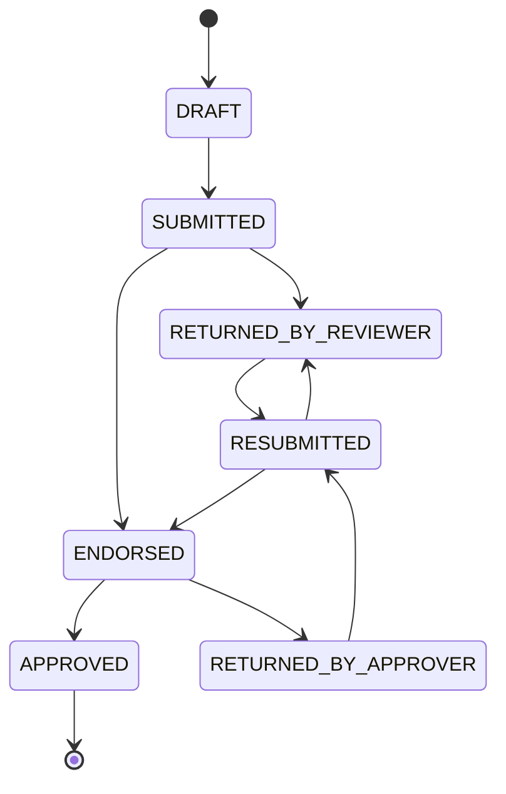

# Phase 00 — Foundation: direction, tokens, shell, shared primitives

**Milestone:** M0 · **Routes:** none of its own (app layout; optional dev-only
component gallery)
**Depends on:** nothing · **Unblocks:** every other phase
**Source:** `par-ui-ux-spec.md` §1–§6, §8.3–§8.4, §8.7–§8.9, §9.4, §10–§13, §15

This phase must ship before any page phase. It defines the palette, type,
spacing, status language, navigation, shell, and the shared components that page
phases consume. A page phase that changes these primitives is out of scope.

---

## 1. Direction

An **institutional civic interface** for a university records system: navy
chrome, white working surfaces, a cream "paper" facsimile, serif document
typography, gold used only as a seal-like accent, and maroon reserved for
returned reports and destructive actions. Navigation is a **navy top bar with
five role-filtered destinations and a second row of section tabs**. The landing
screen is a **role-aware work inbox that leads with what needs the user's
action**. Work is **compact and table-first**; the report itself is presented as
a **document facsimile** with a print-preview mode. Decisions happen in a
**right-side drawer** over the report, so the reviewer never loses the document.
On wide monitors, lists become **master–detail**; on the office's 1366×768
laptops, rows open a full page.

The system should feel like _the paper process, done properly_ — not a generic
SaaS tool and not a literal scan of a form.

| Decision                              | Chosen because                                                                                               | Rejected                                                         |
| ------------------------------------- | ------------------------------------------------------------------------------------------------------------ | ---------------------------------------------------------------- |
| Navy top bar + section tabs           | Official register; five destinations fit 1366 px; tabs absorb sub-pages without a sidebar eating table width | Left sidebar, dashboard-tile hub, icon rail                      |
| Role-aware work inbox                 | Every role starts with a to-do list                                                                          | "Always My reports", counters-only dashboard                     |
| Wizard to create, single page to edit | First submission is field-heavy; corrections are targeted                                                    | One long form, wizard for edits, two-step form                   |
| Facsimile + record mode               | Reviewers read the paper form; workflow needs a scannable screen                                             | Paper-only, plain record only                                    |
| Master–detail ≥1440 px                | Fast triage on large monitors without cramping laptops                                                       | Split everywhere, never split, summary-only pane                 |
| Decision drawer                       | Keeps document and attachments visible while writing a return                                                | Dedicated review screen, inline action bar, confirm-only dialogs |
| shadcn-svelte on Tailwind 4           | Owned, accessible components matching the existing Tailwind setup                                            | Bits UI bare, Skeleton/Flowbite, hand-rolled                     |
| Compact, table-first                  | Office triages dozens of rows; search and exports are tabular                                                | Card-first, density toggle                                       |
| Official form terminology             | Matches paper process, exports, training                                                                     | Plain-language labels                                            |
| Light + system dark                   | Cheap preference win; printing and facsimile stay light                                                      | Light only, dark-first                                           |

### Design principles

1. **The report is the hero.** Every screen gets the user to a report, moves one
   forward, or finds a stored report.
2. **Action before information.** "Returned to you (2)" precedes "Recent
   activity".
3. **Status is never color alone.** Label + icon/shape + color.
4. **Compact, not cramped.** 40 px rows, 13 px table type, generous horizontal
   padding; density from structure, not shrinking targets.
5. **Paper where it matters.** The facsimile earns serif type, cream stock, and
   ruled sections; the chrome stays a modern application.
6. **One screen, one primary action.** One filled navy button per page.
7. **No dead ends.** Empty, failed, denied, error states name the next action.
8. **Keyboard is a shortcut, never a requirement.**

---

## 2. Visual language, tokens, status

Put these in `apps/web/src/app.css` as CSS custom properties. Components use
tokens, never raw hex. Values are starting tokens; confirm against the official
brand guide before M1 ships.

### 2.1 Palette (light)

| Token                | Hex       | Role                                                 |
| -------------------- | --------- | ---------------------------------------------------- |
| `--brand-navy-900`   | `#0B1733` | Top bar, headings, darkest text                      |
| `--brand-navy-800`   | `#152452` | Primary buttons, active tab, links                   |
| `--brand-navy-700`   | `#1E3372` | Hover on primary, focus ring                         |
| `--brand-navy-100`   | `#E7EBF5` | Selected rows, subtle navy fills                     |
| `--brand-gold-600`   | `#B8862B` | Accent rules, active underline, letterhead seal line |
| `--brand-gold-400`   | `#D9AE5F` | Endorsed status, decorative only                     |
| `--brand-gold-100`   | `#F7EFDC` | Endorsed badge background                            |
| `--brand-maroon-800` | `#7A1F1F` | Returned status, destructive/return actions          |
| `--brand-maroon-100` | `#F5E6E6` | Returned badge background                            |
| `--surface-cream`    | `#FBF8F2` | Facsimile paper, print preview                       |
| `--surface-page`     | `#F6F7F9` | App background                                       |
| `--surface-card`     | `#FFFFFF` | Cards, tables, forms                                 |
| `--border`           | `#DDE2EA` | Default border                                       |
| `--text-primary`     | `#111827` | Body text                                            |
| `--text-secondary`   | `#5B6472` | Labels, metadata                                     |
| `--text-disabled`    | `#9AA3B2` | Disabled controls                                    |
| `--success-700`      | `#166534` | Approved                                             |
| `--success-100`      | `#DCFCE7` | Approved badge                                       |
| `--info-700`         | `#1D4ED8` | Submitted / resubmitted                              |
| `--info-100`         | `#DBEAFE` | Submitted badge                                      |
| `--warning-700`      | `#92400E` | Attention, stale queue items                         |

Rules: gold is never a button color and never the only state signal. Maroon is
never "delete" alone; it means "sent back" in workflow contexts and destructive
in menus — the label disambiguates. Primary actions are navy, one per screen.

### 2.2 Status mapping (shared enum)

| Status                 | Badge label          | Color                                           | Icon/shape       |
| ---------------------- | -------------------- | ----------------------------------------------- | ---------------- |
| `DRAFT`                | Draft                | Neutral slate (`--text-secondary` on `#EEF1F5`) | Pencil           |
| `SUBMITTED`            | Submitted            | Info blue                                       | Inbox            |
| `RESUBMITTED`          | Resubmitted          | Info blue                                       | Inbox with arrow |
| `RETURNED_BY_REVIEWER` | Returned by reviewer | Maroon                                          | U-turn arrow     |
| `RETURNED_BY_APPROVER` | Returned by approver | Maroon                                          | U-turn arrow     |
| `ENDORSED`             | Endorsed             | Gold                                            | Forward arrow    |
| `APPROVED`             | Approved             | Success green                                   | Check            |

Counts always show the badge label in text; color is secondary. `StatusBadge`
and `NextStepStrip` are built **in this phase** so every page shares one mapping.

### 2.3 Typography

Montserrat is the UI face, self-hosted (latin subset, variable woff2 in
`apps/web/static/fonts/`) so the Tauri build stays offline-safe; the system
stack remains the fallback.

| Role                                    | Stack                                                            | Size / weight                   |
| --------------------------------------- | ---------------------------------------------------------------- | ------------------------------- |
| UI body                                 | `"Montserrat", system-ui, -apple-system, "Segoe UI", sans-serif` | 14/400; tables 13               |
| UI headings                             | Same sans                                                        | H1 24/600, H2 18/600, H3 15/600 |
| Labels                                  | Same sans                                                        | 12/500, `--text-secondary`      |
| Document (facsimile, print, letterhead) | `Georgia, "Times New Roman", serif`                              | Body 13.5/1.55; title 20/600    |
| Tracking numbers, dates in tables       | `ui-monospace, "Cascadia Mono", Consolas, monospace`             | Tabular numerals                |

Do not add Source Serif 4 in M0.

### 2.4 Spacing, radius, elevation

- 4 px base: 4, 8, 12, 16, 24, 32, 48. Page gutter 24 px.
- Control heights: 32 default, 28 compact table actions, 36 primary.
- Table rows 40 px; header 36 px; never below 36 px.
- Radius: 6 px cards/controls, 4 px badges, 2 px document rules. No pills except
  count badges (full radius).
- Elevation: one level only (`0 1px 2px rgba(11,23,51,.06)`); drawers use a
  stronger shadow; no floating cards on cards.
- Focus ring: 2 px `--brand-navy-700`, 2 px offset, visible on every interactive
  element including table rows.

### 2.5 Dark mode

`prefers-color-scheme: dark` flips semantic tokens. The facsimile stays light
(paper is paper) with a subtle warm border; print always uses light tokens.

| Token                      | Dark value                             |
| -------------------------- | -------------------------------------- |
| Page                       | `#0B1220`                              |
| Card                       | `#111A2E`                              |
| Border                     | `#24304A`                              |
| Text primary               | `#E6EAF2`                              |
| Text secondary             | `#A7B0C2`                              |
| Primary                    | `#6C8AE4`                              |
| Info/success/maroon badges | 20% tinted backgrounds, 300-level text |

The top bar stays `#0B1733` in both themes.

### 2.6 Iconography

Lucide via shadcn-svelte defaults: 16 px tables, 18 px buttons, 20 px nav. Status
icons are semantic, not decorative. The seal appears only in the header (28 px),
auth card (64 px), and print letterhead.

### 2.7 State machine

The API is the source of truth; the UI maps these states 1:1. Do not add
intermediate states or guess transitions.



### 2.8 Next-step text

`NextStepStrip` renders exactly this copy from the API status and timestamps.
Never say "In progress" or invent an intermediate state.

| Status                 | Next-step text                                           |
| ---------------------- | -------------------------------------------------------- |
| `DRAFT`                | "Not yet submitted · Next: complete the form and submit" |
| `SUBMITTED`            | "With OVPCASSS reviewer · Next: review"                  |
| `RESUBMITTED`          | "With OVPCASSS reviewer · Next: re-review"               |
| `RETURNED_BY_REVIEWER` | "Returned to submitter · Next: revise and resubmit"      |
| `ENDORSED`             | "With approving officer · Next: approve"                 |
| `RETURNED_BY_APPROVER` | "Returned to submitter · Next: revise and resubmit"      |
| `APPROVED`             | "Completed 20 Mar 2026 · Acknowledgement available"      |

---

## 3. Information architecture and shell

### 3.1 Routes

| Route                                                                         | Destination                  | Roles                        | Nav location           |
| ----------------------------------------------------------------------------- | ---------------------------- | ---------------------------- | ---------------------- |
| `/`                                                                           | Work inbox                   | all signed-in                | Home                   |
| `/reports`                                                                    | My reports                   | all                          | Reports → All          |
| `/reports?tab=drafts`                                                         | Drafts                       | all                          | Reports → Drafts       |
| `/reports?tab=returned`                                                       | Returned to me               | SUBMITTER (others read-only) | Reports → Returned     |
| `/reports/new`                                                                | Create wizard                | SUBMITTER                    | Reports → + New report |
| `/reports/[id]`                                                               | Facsimile (record)           | all with access              | row click              |
| `/reports/[id]?print=1`                                                       | Print preview                | all with access              | toggle                 |
| `/reports/[id]/edit`                                                          | Edit returned                | owning SUBMITTER             | Returned row           |
| `/review`                                                                     | Review queue                 | REVIEWER                     | Queues → Review        |
| `/review/[id]`                                                                | Facsimile + review context   | REVIEWER                     | row click              |
| `/approval`                                                                   | Approval queue               | APPROVER                     | Queues → Approval      |
| `/approval/[id]`                                                              | Facsimile + approval context | APPROVER                     | row click              |
| `/search`                                                                     | Repository search            | REVIEWER, APPROVER, ADMIN    | Repository → Search    |
| `/exports`                                                                    | Monitoring exports           | REVIEWER, APPROVER, ADMIN    | Repository → Exports   |
| `/notifications`                                                              | In-app inbox (**new route**) | all                          | bell menu              |
| `/profile`                                                                    | Profile, password, signature | all (signature: APPROVER)    | avatar menu            |
| `/admin/users`                                                                | Users & roles                | ADMIN                        | Admin → Users          |
| `/admin/reference-data`                                                       | Reference data               | ADMIN                        | Admin → Reference data |
| `/admin/audit`                                                                | Audit log                    | ADMIN                        | Admin → Audit          |
| `/login`, `/register`, `/verify-email`, `/forgot-password`, `/reset-password` | Auth                         | public                       | none (auth layout)     |

Existing scaffold routes are preserved. `/search` is labelled **Repository** in
the UI; `/exports` is a Repository tab. This keeps URLs stable while labels match
office vocabulary.

### 3.2 Top navigation

Five destinations, filtered by role; a user with several capabilities sees the
union. A Submitter never sees Queues, Repository, or Admin.

| Nav item   | Submitter | Reviewer | Approver | Admin |
| ---------- | :-------: | :------: | :------: | :---: |
| Home       |     ✓     |    ✓     |    ✓     |   ✓   |
| Reports    |     ✓     |    ✓     |    ✓     |   ✓   |
| Queues     |           |    ✓     |    ✓     |       |
| Repository |           |    ✓     |    ✓     |   ✓   |
| Admin      |           |          |          |   ✓   |

- **Reports** is the submitter's home for work; reviewers/approvers see it as
  their read-only trail.
- **Queues** is one destination with two tabs (Review, Approval). A user with
  both capabilities sees both tabs; a zero count still renders.
- **Repository** holds Search and Exports.
- Admin does **not** gain review/approve actions by being Admin.
- Profile is not a nav item; it lives in the avatar menu with Sign out.

### 3.3 Shell anatomy

```
┌──────────────────────────────────────────────────────────────────────────────┐
│ [seal] OVPCASSS Paperless PAR   Home  Reports  Queues  Repository  Admin     │ 56 px, navy
│                                              [/ Search]  [bell 3]  [JD ▾]     │
├──────────────────────────────────────────────────────────────────────────────┤
│  Reports    All   Drafts   Returned   Approved              [+ New report]    │ 40 px, white
├──────────────────────────────────────────────────────────────────────────────┤
│   page content                                             max-width 1440    │
└──────────────────────────────────────────────────────────────────────────────┘
```

- The tab row renders only inside a section (Reports, Queues, Repository, Admin)
  and only when there is more than one tab.
- Active nav item: 2 px gold underline + white text. Active tab: navy text + 2 px
  navy underline.
- `/` search affordance visible to REVIEWER/APPROVER/ADMIN only.
- Bell shows unread count (cap "9+"); menu links to `/notifications`.
- Avatar menu: full name + role, Profile, Keyboard shortcuts, Sign out.
- Skip link ("Skip to content") is the first focusable element.
- Below 1024 px: a single centered notice ("This system is designed for screens
  1024 px and wider"); auth pages are exempt.

### 3.4 Build in this phase

- `app.css`: semantic tokens, base type, focus-visible utility, reduced-motion
  rule.
- `AppShell` / `AppHeader` (navy bar, nav, search affordance, bell slot, avatar
  menu), `SectionTabs`, `BrandSeal`.
- Auth layout wrapper (cream page, 400 px card, seal slot) — pages are phase 01.
- Shared primitives: `StatusBadge`, `NextStepStrip`, `EmptyState`, `ErrorState`,
  `SkeletonTable`, `SkeletonDocument`, `ConfirmDialog`, `ToastRegion`, table and
  form field styles/helpers.
- Global shortcut registry with input/textarea suppression (`/`, `?`, `Esc`,
  `Ctrl/Cmd+K` wiring point — the help sheet and palette are phase 12).
- Replace the current placeholder shell; unbuilt routes keep a token-styled
  placeholder that names the phase that will build them.
- Optional `/dev/components` gallery only if the open question is answered yes;
  exclude it from the Tauri build.

---

## 4. Shared patterns (apply in every phase)

### 4.1 Tables (§8.3)

- Sticky header within the scrolling region; first column sticks horizontally in
  exports preview only.
- Row hover `#F8FAFC`, selected row `#E7EBF5`. Whole row clickable; the ⋯ menu
  stops propagation.
- Sort indicator ▲/▼ on the active header; unsorted headers are quiet.
- Numeric columns right-align with tabular numerals; status columns are badges;
  dates are monospace.
- No bulk selection, no checkbox column in v1.
- Below 1280 px, hide Type and College before title or status.

### 4.2 Forms (§8.4)

- Labels above inputs, 12 px medium; optional fields say "Optional" in the label
  row (no asterisk-only ambiguity).
- Validate on blur and submit, never while typing. Error text below the field
  with a 16 px alert icon, not color alone.
- Error summary at the top of wizard steps and the edit page, linking to the
  first invalid field.
- Inline help only for format ("DD MMM YYYY") and domain rules; never rename
  labels.
- Destructive confirmations name the object ("Delete draft "Marine survey"?").
- Disabled controls always have an adjacent reason, not a tooltip alone.

### 4.3 Toasts (§8.7)

- Bottom-right, 4 s, one at a time (stack up to 3), `aria-live="polite"`,
  dismissible. Success and error only — no neutral toasts.
- Four surfaces, one job each: bell/inbox (things that happened to you), nav
  counters (queues needing work), inbox callouts (the same work on the landing
  page), toasts (confirmation of your own action).
- No toast for background sync unless it fails.

### 4.4 Loading, empty, error (§8.8)

- Lists: 8 skeleton rows matching real column widths; no table spinners.
- Forms and facsimile: skeleton blocks for document and rail.
- Actions: button spinner + disabled, label changes to a verb ("Submitting…").
- Full-page empty: no seal; icon + title + one sentence + primary action.
- Full-page error: title ("We could not load this report"), one sentence, request
  id in monospace, Retry, and "Back to reports".
- Permission denied: names the required role, no Retry.
- 404 report: "This report does not exist or you do not have access" for both
  cases, to avoid leaking existence.

### 4.5 Keyboard (§8.9)

| Scope  | Key              | Action                                    |
| ------ | ---------------- | ----------------------------------------- |
| Global | `/`              | Focus search (Repository or table filter) |
| Global | `Ctrl/Cmd+K`     | Command palette                           |
| Global | `?`              | Shortcut help                             |
| Global | `Esc`            | Close drawer/dialog                       |
| Tables | `j` / `k` or ↓/↑ | Move row focus                            |
| Tables | `Enter`          | Open focused row                          |
| Report | `R`              | Return (opens drawer)                     |
| Report | `E`              | Endorse                                   |
| Report | `A`              | Approve                                   |
| Wizard | `→` / `←`        | Next / Back step                          |
| Wizard | `Ctrl/Cmd+S`     | Save draft                                |

Single-letter shortcuts are suppressed in inputs, textareas, and the narrative
editor. Every shortcut has an equivalent visible control.

The wizard's `→` / `←` yield to whatever holds the arrow: a text field, an open
dialog, or a widget that already handled the key. `Alt` + arrow moves steps
either way, and the action bar shows the key beside the button it stands for.

### 4.6 Accessibility and content (§11)

- Target **WCAG 2.2 AA**. Text contrast ≥4.5:1; navy/white and white/navy pass;
  gold is decorative only.
- Full keyboard operability: logical tab order, skip link, visible focus, drawer
  focus trap with restore, Escape closes.
- Tables use `<th scope="col">`, caption where useful, `aria-sort`.
- Status is text + icon + color.
- Touch targets ≥32 px even in compact tables (28 px pointer target acceptable
  for row menus, with 8 px spacing).
- Motion: 120 ms fades/slides for drawers and toasts; respect
  `prefers-reduced-motion`.
- 200% zoom at 1280 px must not clip actions; the rail stacks below the document.
- English only, formal institutional voice. No exclamation marks, "Oops", or
  jokes.
- Dates: `14 Mar 2026` in tables; `14 March 2026, 9:12 AM` in prose; always
  Asia/Manila; API values stay UTC. Tracking numbers are monospace and copyable.
- Empty-state copy names the next action.

### 4.7 Responsive (§12)

| Width     | Behavior                                                                                                      |
| --------- | ------------------------------------------------------------------------------------------------------------- |
| ≥1440     | Master–detail for Queues and Repository; facsimile + rail side by side; full tab row                          |
| 1280–1439 | Lists navigate to detail pages; facsimile + rail side by side (rail 280 px)                                   |
| 1024–1279 | Single column; rail stacks below document; wizard rail becomes completeness bar; table hides Type and College |
| <1024     | Centered notice; auth pages remain usable                                                                     |
| Print     | A4 portrait, light tokens, no chrome                                                                          |

No mobile design in v1; the decision is explicit.

---

## 5. Component ownership

| Component                               | Phase | Notes                                          |
| --------------------------------------- | ----- | ---------------------------------------------- |
| `AppHeader`, `SectionTabs`, `BrandSeal` | 00    | Navy bar, route tabs, logo                     |
| `StatusBadge`, `NextStepStrip`          | 00    | Status → label/color/icon; one-line state text |
| `EmptyState`, `ErrorState`              | 00    | Full-page variants                             |
| `SkeletonTable`, `SkeletonDocument`     | 00    | Loading                                        |
| `ConfirmDialog`                         | 00    | Names the object and consequence               |
| `ToastRegion`                           | 00    | Bottom-right, aria-live                        |
| `WorkInbox`, `OnboardingChecklist`      | 02    | Ordered actionable sections                    |
| `ReportTable`                           | 05    | Sortable, sticky header, row menu              |
| `FilterBar`                             | 05    | URL state, chips, clear                        |
| `ReportWizard`, `CompletenessChecklist` | 06    | 4-step shell, autosave, step validation        |
| `AttachmentUploader`, `AttachmentList`  | 06    | Presign/confirm states                         |
| `WorkflowStepper`                       | 08    | Five stages + return chips                     |
| `FacsimileDocument`, `ReportMetaGrid`   | 08    | Record + print variants; em dash for empty     |
| `CommentThread`, `AuditTimeline`        | 08    | Rounds; audit grouped by day                   |
| `DecisionDrawer`                        | 09    | Role-specific action forms                     |
| `MasterDetailLayout`                    | 09    | Split ≥1440, page below                        |
| `SignaturePad`, profile signature card  | 09    | Draw + upload tabs, preview                    |
| `FilterPanel`                           | 10    | Rich repository filters                        |
| `NotificationMenu`                      | 11    | Newest three + unread count                    |
| `Kbd`, `ShortcutHelpDialog`             | 12    | Help sheet; palette                            |
| `AuditFilterPanel`                      | 13    | Two-pane filters                               |
| `ExportPreviewTable`                    | 14    | Sticky first column, missing-value warnings    |
| `ReferenceDataTabs`, `EntryDrawer`      | 04    | Official list, soft delete                     |

Rules: each component under 400 lines; feature-specific components stay in the
feature folder; only cross-feature primitives live in `lib/components`; no
`utils/` folder.

---

## 6. Process traceability (§15)

| Source step                     | Screen/pattern                                     |
| ------------------------------- | -------------------------------------------------- |
| 1 Sign in                       | `/login`                                           |
| 2 Select completed activity     | Wizard step 1                                      |
| 3 Fill form                     | Wizard steps 2–3, `/reports/[id]/edit`             |
| 4 Upload attachments            | Wizard step 4, `AttachmentUploader`                |
| 5 Validate completeness         | `CompletenessChecklist`, server validation summary |
| 6 Return to user for completion | Inline errors + checklist (not a workflow return)  |
| 7 Submit                        | Wizard submit action                               |
| 8 Reference number + timestamp  | Facsimile reference block, toast                   |
| 9 Notify reviewers              | Email + review queue counter                       |
| 10 Review                       | `/review`, facsimile, decision drawer              |
| 11 Return with comments         | Decision drawer, comment thread                    |
| 12 Revise and resubmit          | `/reports/[id]/edit`                               |
| 13 Re-review                    | `/review`, `RESUBMITTED` badge                     |
| 14 Endorse                      | Decision drawer, `ENDORSED`                        |
| 15 Approve                      | `/approval`, decision drawer + signature check     |
| 16 Return for revision          | Approver return drawer                             |
| 17 Record approval              | Next-step strip, facsimile signatures              |
| 18 Digital acknowledgement      | Acknowledgement PDF on approved facsimile          |
| 19 Store in repository          | Repository default view                            |
| 20 Search/retrieve              | `/search`                                          |
| 21 Audit trail                  | History timeline, `/admin/audit`                   |
| 22 End                          | `APPROVED` terminal state, "Completed" strip       |

---

## 7. Acceptance checklist

- [ ] `app.css` defines every light token, dark overrides, base type, focus ring,
      and reduced-motion rule; no component uses raw hex for a semantic color.
- [ ] Dark mode flips surfaces/text/badges; top bar stays `#0B1733`; a
      light-only facsimile surface is available as a token.
- [ ] Shell matches the anatomy: 56 px navy bar, 40 px tab row only inside a
      multi-tab section, 1440 px content max width, 24 px gutter.
- [ ] Nav is role-filtered per the matrix; Submitter never sees Queues, Repository,
      or Admin; Admin does not gain review/approve actions.
- [ ] Active nav = gold underline + white text; active tab = navy underline.
- [ ] Skip link is first focusable; every interactive element shows the 2 px
      focus ring; drawer/dialog primitives trap and restore focus.
- [ ] Bell slot, avatar menu (name + role, Profile, Keyboard shortcuts, Sign out),
      and `/` search affordance render for the correct roles.
- [ ] <1024 px shows the notice; auth routes are exempt.
- [ ] `StatusBadge` renders all seven statuses with label, icon, and color; a
      text-only rendering is still unambiguous.
- [ ] `NextStepStrip` matches the §2.8 mapping for all seven statuses.
- [ ] `EmptyState`, `ErrorState` (with request id + Retry), permission-denied, and
      404 variants exist and are reachable in the gallery or a scratch route.
- [ ] Tables: 40 px rows, sticky header, sort indicator, row hover/selected
      colors, no checkbox column, ≤1280 px column priority.
- [ ] Forms: labels above, "Optional" text, blur/submit validation, error summary
      linking to the first invalid field.
- [ ] Toasts: bottom-right, 4 s, max 3, `aria-live="polite"`, dismissible.
- [ ] Global shortcut handler ignores `j/k/R/E/A` while focus is in an input,
      textarea, or the narrative editor.
- [ ] Skeleton tables use 8 rows matching final column widths; no table spinners.
- [ ] `pnpm lint`, `pnpm typecheck`, and `pnpm build` were run and their results
      reported. If dependencies are not installed, say so explicitly instead of
      claiming a pass.

## 8. Out of scope

- Any screen content beyond the shell, auth layout wrapper, and shared
  primitives.
- `/dev/components` unless the open question is answered yes.
- Brand finalization (hex values pending the official guide) — use the sampled
  tokens and flag the risk.
- Mobile layouts.

## 9. Open questions blocking this phase

1. Confirm the palette hex values and whether the seal may appear in app chrome
   and print letterhead.
2. Is a dev-only `/dev/components` gallery acceptable, and is it excluded from the
   Tauri build?
3. Confirm dark mode keeps the facsimile light rather than tinting the document.
