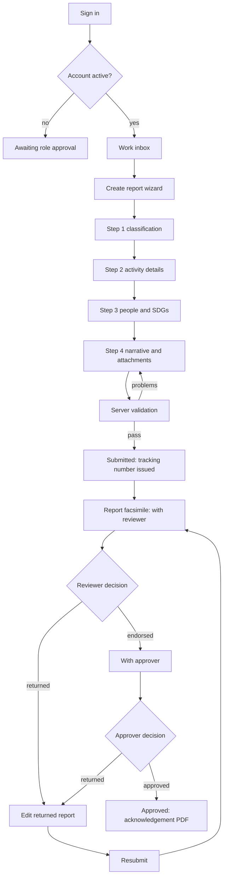

# Phase 06 — Create report wizard, attachments, completeness

**Milestone:** M3
**Routes:** `/reports/new` (four steps, step state in the URL: `?step=1..4`)
**Depends on:** 00-foundation (form primitives, toast, skeletons), 04 (reference
data dropdowns and attachment requirements), 05 (route and draft rows)
**Source:** `par-ui-ux-spec.md` §7.5, §8.4, §8.5, §8.8, §12; project spec §6 form
fields and §14 Q2 (attachment labels)

First submission is the highest-anxiety screen in the system. One question per
step, one primary action per step, and nothing is ever lost.

---

## 1. Context for this run

- Role: SUBMITTER only. Others get permission denied; Admin does not inherit
  submit rights.
- Stepper: four steps, `?step=` is the source of truth, browser back/forward
  moves between steps without losing data.
- One primary action per step: **Continue** on steps 1–3, **Submit report** on
  step 4. **Back** is outline; **Save draft and exit** is a text action in the
  header.
- Autosave is local-first and silent. There is no "unsaved changes" panic copy
  during normal editing; the header always shows the last save time.
- Forms follow foundation §4.2: labels above, `*` for required and the word
  "Optional" for optional fields, validate on blur/submit, error summary at the
  top of the step linking to the first invalid field.
- Never invent field limits, required-ness, or options. Options come from
  reference data; required-ness comes from the API/Zod contract.
- A failed submit shows the standard error state and keeps the draft; do not add
  an offline banner or queue the report for later.

---

## 2. Layout

```
┌──────────────────────────────────────────────────────────────────────────────┐
│  New post-activity report                        [Save draft and exit]       │
│  Step 2 of 4 — Activity details           ●───●───○───○                      │
├──────────────────────────────────────────────────────────────────────────────┤
│  ┌── main 720 px ────────────────────────────┐  ┌── rail 280 px ──────────┐  │
│  │  Title of the activity *                   │  │ COMPLETENESS            │  │
│  │  [_______________________________________] │  │ ✓ Type and class.       │  │
│  │                                            │  │ ✓ Campus and college    │  │
│  │  Date of the activity *                    │  │ ○ Dates                 │  │
│  │  [ 12 Mar 2026 ]  to  [ 13 Mar 2026 ]      │  │ ○ Narrative             │  │
│  │                                            │  │ ○ Attachments (0/2)     │  │
│  │  Location *                                │  │                         │  │
│  │  [_______________________________________] │  │ Draft saved 09:12       │  │
│  └────────────────────────────────────────────┘  └─────────────────────────┘  │
├──────────────────────────────────────────────────────────────────────────────┤
│  [ Back ]                                                   [ Continue ]      │
└──────────────────────────────────────────────────────────────────────────────┘
```

- Page header: title "New post-activity report", save status, **Save draft and
  exit**. The step label sits under the title, with the four-dot stepper.
- Main column max 720 px; rail 280 px, sticky. Below 1280 px the rail collapses
  to a one-line completeness meter above the form ("Completeness 3 of 5 —
  Attachments missing").
- Action bar is sticky at the bottom of the viewport: Back (outline) left,
  primary right. It never covers the last field; add bottom padding to the form.
- No app-level tab row for the wizard; it is a focused task page.

---

## 3. Steps

### Step 1 — Activity classification

Fields: activity type (Off-campus / Educational tour / In-campus), classification,
campus, college/unit, department, office, level (Graduate/Undergraduate).

- Type is the first field because it drives tracking-number prefix, attachment
  requirements, and the export sheet.
- Campus filters the available colleges/units; changing campus clears an
  incompatible college selection and says why inline.
- Department and Office are admin-seeded selects with an "Other (specify)"
  option that reveals a text input (pending confirmation, project spec §14 Q5).
- Level options are exactly Graduate and Undergraduate.
- Classification options come from the API; do not hardcode a list in the
  component.

### Step 2 — Activity details

Fields: title, start date, end date, location.

- Dates use a text input with a calendar popover; typed format `DD MMM YYYY`.
- End date cannot precede start date; validate on blur with an inline message.
- Single-day activities may set both dates the same; the facsimile renders one
  date, not a range.
- Title is the report's human identifier in every table; keep the 2-line clamp
  and no character counter unless the API supplies a limit.

### Step 3 — People and outcomes

Fields: total number of students, total number of PIC, PIC rows, SDG multi-select.

- Counts are numeric inputs with tabular numerals; no decimals.
- PIC rows: name, email, phone, with add/remove. The row count must stay
  consistent with "total number of PIC"; a mismatch shows a clear inline message.
  Do not silently overwrite either value.
- Email validates format on blur; phone accepts digits, spaces, `+`, `-`,
  parentheses.
- Remove row asks for confirmation only when the row has content; empty rows
  remove immediately.
- SDG selection is a searchable multi-select with numbered chips ("1 No
  poverty"); at least one is required. Selected chips are removable; search
  matches number and title.

### Step 4 — Narrative and attachments

Fields: narrative editor, attachment uploader, completeness checklist, review
summary, **Submit report**.

- Narrative editor is plain text with preserved paragraphs and line breaks,
  spellcheck on, and a visible "Formatting is limited to paragraphs" helper. No
  rich HTML from users; sanitization is server-side.
- Review summary lists every section with an Edit link back to the step; values
  use the same labels as the form.
- Submit is blocked until the API validation passes and all attachments are
  `CONFIRMED`.

---

## 4. Behavior

### Autosave and drafts

- Autosave to the platform `DraftStore` on field blur and every 20 seconds.
  Web uses IndexedDB; desktop uses local SQLite. The same interface, no branching
  in components.
- Header shows "Draft saved 09:12" (24-hour, Asia/Manila). "Saving…" appears
  only while a save is in flight; a failed autosave shows "Not saved — Retry" as
  a text action, never a modal.
- Step changes never lose data. A new report gets a local draft id immediately;
  the server draft id is created when the API first persists it.
- **Save draft and exit** writes, toasts "Draft saved", and goes to
  `/reports?tab=drafts`.
- Leaving with unsaved changes (navigation, back link, browser close where
  detectable) shows a confirm dialog: **Save draft**, **Discard**, **Stay**.
  Escape = Stay. Discard names what will be lost.
- Restoring a draft opens at the last step with a one-line notice "Restored from
  a saved draft" and the save time.

### Validation and navigation

- **Continue** validates only the current step; errors render inline and the
  error summary focuses/scrolls to the first invalid field. Completed steps can
  be revisited from the stepper; forward jumps validate intermediate steps.
- **Back** never validates.
- Step 4 submit calls `POST /reports/:id/validate`; the server's field list is
  rendered as a linked error summary. Do not re-implement server rules in the
  client.
- Submit button shows "Submitting…" and is disabled until the response.
- On success: full-page transition to the facsimile, toast "Report submitted ·
  OFF-2026-0015", and a copy button for the tracking number in the toast or
  header. The draft disappears from the drafts list.
- Double submit is impossible: disable after the first click and use the API's
  idempotency behavior.

### Keyboard

- `→` / `←` move steps when no text field, dialog, or widget holds the arrow;
  `Alt+→` / `Alt+←` move steps even while typing, and never from the narrative
  editor. The action bar shows the key beside Back and Continue.
- `Ctrl/Cmd+S` saves a draft and prevents the browser save dialog.
- Enter in a single-line input does not submit the report; only Continue
  (steps 1–3) or Submit report (step 4) advances. Enter may move to the next
  field.

---

## 5. Completeness checklist

Rail card (sticky; collapsed meter below 1280 px):

- Items: **Type and class**, **Campus and college**, **Dates**, **Narrative**,
  **Attachments (n/m)**. The list is fixed and ordered.
- Each item shows ✓ (complete) or ○ (missing) plus text; never color alone.
- Attachment denominator comes from `ref_attachment_requirements` for the chosen
  activity type: required labels and minimum counts. Missing required labels
  appear here as "Attendance sheet (required)" with a link to the uploader.
- Incomplete items are informational, not blocking, until Submit; the server
  remains the authority.
- The meter is a segmented bar with the text "3 of 5 complete". No percentage
  without a denominator.

---

## 6. Attachments (§8.5)

- Drop zone plus **Choose files**. Accepts the server allowlist; 25 MB per file.
  Rejections name the file and the limit ("Attendance.pdf is 31 MB; the limit is
  25 MB").
- Each row: file icon, name, size, label select (from the required/available
  labels for the activity type), status chip, progress, remove.
- Status chips: **Uploading**, **Pending**, **Confirmed**, **Failed**. Failed
  rows offer Retry. Upload progress is per file.
- Submit is blocked until every attachment is `CONFIRMED`; the block reason is
  adjacent to the Submit button, not a tooltip.
- Required labels missing from the upload set appear in the completeness
  checklist; they do not open a blocking modal.
- Preview: PDFs and images open in a new tab via a short-lived signed URL; office
  files download. Never expose a raw object key.
- Removing an uploaded attachment asks for confirmation and names the file.
- Duplicate file names are allowed unless the API says otherwise; do not invent a
  dedupe rule.

---

## 7. States

- Loading a draft: skeleton form blocks matching the step; no full-page spinner.
- Autosave failure: inline text with Retry, data stays in the form.
- Server validation failure: linked summary at the top of step 4 and inline
  field errors.
- Submit network failure (web): standard error alert with Retry; the form stays
  intact and the draft remains saved.
- Permission denied: names the Submitter role; no form.
- Draft restored but server copy deleted/returned: show a clear choice to keep
  the local draft as a new report or discard; never overwrite a returned report.
- 409 on submit: the conflict dialog defined in phase 07; never merge silently.

---

## 8. Acceptance checklist

- [ ] Only SUBMITTER can open the wizard; others see permission denied.
- [ ] `?step=` drives the stepper and browser back/forward works without data
      loss.
- [ ] Step 1 has type, classification, campus, college/unit, department, office,
      level; campus filters colleges; department/office support "Other
      (specify)".
- [ ] Step 2 has title, start/end date (`DD MMM YYYY`, calendar popover),
      location; end-before-start is caught inline.
- [ ] Step 3 has student count, PIC count, add/remove PIC rows with name, email,
      phone, and a searchable numbered SDG multi-select with at least one
      required.
- [ ] Step 4 has the narrative editor, uploader, completeness checklist, review
      summary with Edit links, and Submit.
- [ ] Autosave fires on blur and every 20 s; header shows "Draft saved HH:mm";
      failure shows "Not saved — Retry" and the data stays in the form.
- [ ] The web `DraftStore` uses IndexedDB (not the in-memory scaffold) so a
      draft survives a reload; desktop uses its SQLite store behind the same
      interface.
- [ ] Leaving with unsaved changes offers Save draft / Discard / Stay; Escape
      stays.
- [ ] Continue validates only the current step and focuses the first invalid
      field; Back never validates.
- [ ] Submit calls server validation, renders the returned field list, blocks
      until attachments are `CONFIRMED`, and cannot double-submit.
- [ ] Success goes to the facsimile with toast "Report submitted · <tracking>"
      and a copy action; the draft leaves the drafts list.
- [ ] Attachments: allowlist + 25 MB errors name the file; per-file progress,
      status chips, retry, label select, remove confirm; PDFs/images preview via
      signed URL.
- [ ] Required labels from reference data appear in the checklist, not a blocking
      modal.
- [ ] Rail is sticky at ≥1280 px and collapses to a one-line text meter below.
- [ ] Keyboard: Alt+←/→ steps, Ctrl/Cmd+S saves, Enter does not submit early.
- [ ] Loading, autosave-failure, validation-failure, network-failure, denied, and
      restored-draft states are implemented.
- [ ] `pnpm lint`, `pnpm typecheck`, and `pnpm build` results reported.

## 9. Out of scope

- Edit-returned screen and resubmit (phase 07).
- Server-side validation rules, file type allowlist contents, and attachment
  requirement seeding (backend).
- Rich-text formatting, autosave to a server draft on every keystroke, and
  collaborative editing.

## 10. Open questions

1. Required attachment labels per activity type are still open in the project
   spec (§14 Q2). The uploader and checklist depend on them.
2. Where Programs appear in the form is open (project spec §14 Q4). Do not add a
   program field until answered.
3. Confirm the "Other (specify)" behavior for Department and Office (project spec
   §14 Q5).
4. Confirm whether PIC count must equal the number of PIC rows or may differ
   (e.g. group contacts).

---

## Appendix — submitter journey


