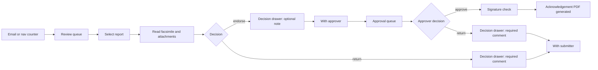

# Phase 09 — Queues, decision drawer, approver signature

**Milestone:** M4
**Routes:** `/review`, `/review/[id]`, `/approval`, `/approval/[id]`;
signature card on `/profile`
**Depends on:** 05 (`ReportTable`, filter bar), 08 (facsimile, rail slot,
comments, history), 06 (`AttachmentList`)
**Source:** `par-ui-ux-spec.md` §7.9, §7.10, §7.14 (signature), §8.4, §8.9,
§12; project spec §9 (separation of duties)

The queue is a backlog, not a feed. Decisions happen over the document, in a
drawer, without losing the facsimile or attachments.

---

## 1. Context for this run

- REVIEWER sees `/review`; APPROVER sees `/approval`; a user with both sees both
  tabs under **Queues**. Admin does not gain either queue by being Admin.
- One primary action per screen: in the queue, none (rows and filters only); in
  the drawer, the decision button — navy for Endorse/Approve, maroon for Return.
- Decisions are audited server-side. The UI never fakes a status change; it
  updates from the API response.
- Separation of duties: a reviewer cannot endorse a report they submitted; an
  approver cannot approve their own report. The action is disabled with an
  adjacent reason, not just a tooltip.
- `StatusBadge`, table rules, form rules, and drawer focus behavior come from
  foundation.
- The full facsimile from phase 08 is reused on detail routes; do not duplicate
  the document component or fork its styles.

---

## 2. Queue layout

Review and approval share one template; columns and actions differ only by role.
The "Queues / Review / Approval" line in the diagram is the shell's
`SectionTabs`; render it once, never as a second in-page tab row.

```
┌──────────────────────────────────────────────────────────────────────────────┐
│  Queues        Review   Approval                                              │
│  Review queue                                    4 reports · oldest 3 days    │
│  [ Type ▾ ] [ Campus ▾ ] [ College ▾ ] [ Sort: Oldest first ▾ ]               │
├──────────────────────────────────────────┬───────────────────────────────────┤
│ TRACKING     TITLE              SUBMITTED│  (master–detail at ≥1440 px)      │
│ OFF-2026-0014 Coastal cleanup   14 Mar   │  ┌─────────────────────────────┐  │
│ INC-2026-0009 Outreach program  15 Mar   │  │ FACTSHEET / FACSIMILE       │  │
│ ...                                      │  │ OFF-2026-0014               │  │
│                                          │  │ Coastal cleanup             │  │
│                                          │  │ [ Endorse ]  [ Return ]     │  │
│                                          │  └─────────────────────────────┘  │
├──────────────────────────────────────────┴───────────────────────────────────┤
│  Showing 1–25 of 4                                      [ 1 ]                 │
└──────────────────────────────────────────────────────────────────────────────┘
```

- Page header: queue name and a one-line backlog summary: "4 reports · oldest 3
  days". Age is working days; age > 3 turns warning-colored **with text** ("4
  days — attention").
- Filter bar: Type, Campus, College, Sort (Oldest first default; Newest first;
  Age). Filters and sort are URL state.
- Table columns: Tracking no., Title, Type, College, Submitted (date), Age
  (working days, warning at >3), Status. The approval queue replaces
  **Submitted** with **Endorsed** (date) so the approver sees when the reviewer
  passed it; the rest of the template is identical.
- Default sort **oldest first**. This is a backlog; never default to newest.
- Row click at ≥1440 px selects the preview pane; below 1440 px navigates to
  `/review/[id]` or `/approval/[id]`.
- Pagination 25 per page, same as other tables.
- No bulk actions, no checkbox column, no row decision menu.

### Master–detail (≥1440 px)

- Left: table, roughly 55% of the content width; right: preview pane.
- Pane header: tracking number, title, status, key facts (type, college,
  submitted, age), and the decision buttons. Buttons open the same drawer as the
  full detail page.
- Pane body: compact facsimile summary (first sections + participant counts) with
  **Open full report** linking to the detail route. The full document is one
  click away, not embedded in a cramped column.
- Selecting another row replaces the pane. After a decision, the row fades out,
  the pane clears to "Select a report to review", and focus moves to the next
  row. No automatic opening of the next report.
- If the pane is open and the row list refreshes, keep the selection if the row
  still exists; otherwise clear the pane and announce it.

### Detail routes

`/review/[id]` and `/approval/[id]` reuse the phase 08 record view with:

- A breadcrumb back to the queue, and the queue's filter/sort preserved in the
  return link.
- The Actions rail filled with the role-correct buttons (Endorse/Return or
  Approve/Return), disabled with reasons when separation of duties or a missing
  signature applies.
- `R`, `E`, `A` shortcuts active (see §5).

### Empty state

"Nothing waiting for review. New submissions appear here and are emailed to
you." / the approval equivalent, plus a link to the Repository. Filtered-empty:
"No reports match these filters." + Clear filters.

---

## 3. Decision drawer

Right-side sheet, 480 px (full width below 640 px), overlay with the document
still visible. Focus trapped, Escape and overlay click close, focus returns to
the trigger.

```
                              ┌────────────────────────────────────┐
                              │ Return report                  [×] │
                              │ OFF-2026-0014 · Coastal cleanup    │
                              │                                    │
                              │ Returned to the submitter with     │
                              │ your comments. They will be asked  │
                              │ to resubmit.                       │
                              │                                    │
                              │ Comment * (visible to submitter)   │
                              │ ┌────────────────────────────────┐ │
                              │ │                                │ │
                              │ └────────────────────────────────┘ │
                              │ [x] Notify submitter by email      │
                              │                                    │
                              │ [ Cancel ]        [ Return report ]│
                              └────────────────────────────────────┘
```

| Action            | Role     | Fields                           | Validation                                             |
| ----------------- | -------- | -------------------------------- | ------------------------------------------------------ |
| Endorse           | REVIEWER | Optional note                    | —                                                      |
| Return (reviewer) | REVIEWER | Required comment, ≥1 char, ≤4000 | Comment required; confirm copy names the submitter     |
| Approve           | APPROVER | Optional note; signature check   | If no signature on file, block with link to `/profile` |
| Return (approver) | APPROVER | Required comment                 | Comment required                                       |

- Title is the action ("Endorse report", "Approve report", "Return report").
  Subtitle: tracking number · title.
- Explain the consequence in one sentence above the fields (who receives it and
  what happens next).
- Comment field: label says visibility ("visible to submitter"); character
  counter appears only near the 4000 limit; no rich text.
- Return drawer includes "Notify submitter by email", checked by default.
- Primary button: navy for Endorse/Approve; maroon for "Return report". Cancel is
  outline/ghost.
- Unsaved comment text triggers "Discard comment?" on close (Escape, overlay, or
  ×). Empty optional notes close without a confirm.
- On success: drawer closes, toast fires ("Report endorsed", "Report approved",
  "Report returned"), the status badge and stepper update **without a full page
  reload**, the queue row disappears, and the History gains the event. There is
  no undo; the audit trail is the recovery path.
- On failure: drawer stays open, inline alert with the request id, comment text
  preserved.
- Approval signature missing: the drawer opens with a notice at the top — "Add
  your signature before approving." — a link to `/profile`, and the primary
  disabled. Do not silently submit and fail. If the API reports the signature was
  removed after the drawer opened, show the same notice on submit.
- Approval with an optional note may append the note to the approval event; never
  overwrite a prior comment.

---

## 4. Profile signature card (APPROVER, M4)

Appended below the Password card on `/profile` (phase 01 page).

- Card title "Signature"; copy: "Your signature appears on approved
  acknowledgements."
- Capture area 600×200 px with two tabs: **Draw** and **Upload**.
  - Draw: pointer/touch canvas, clear and undo. Empty canvas cannot be saved.
  - Upload: PNG/JPEG only; transparent background encouraged; preview at 240 px
    wide; reject files over the server limit with the limit named.
- Preview shows the current signature at 240 px wide with **Replace signature**
  and **Remove signature** (confirm; names the consequence: acknowledgements
  cannot be approved until a signature is added).
- **Save** is disabled until the signature changes; the card has one primary
  action (navy Save) only when the page has no other filled primary. Otherwise
  it is outline and the account Save remains the page's primary.
- Saving uploads the image through the API and returns an object key; never
  expose the key in the DOM.
- Loading/error states inline on the card; failed upload keeps the previous
  signature.
- Only APPROVER users see this card. Submitters, reviewers, and admins do not.

---

## 5. Keyboard

- On report/detail pages only: `R` opens Return, `E` opens Endorse, `A` opens
  Approve. Single letters are suppressed while focus is in an input, textarea, or
  the comment field, and while any dialog is open.
- `Esc` closes the drawer (with the discard confirm if the comment is dirty).
- Enter in the optional note does not submit; the decision button is explicit.
- Every shortcut has a visible button.

---

## 6. States and edge cases

- Queue loading: 8 skeleton rows; preview pane skeleton if a row was selected.
- Queue error: `ErrorState` with request id and Retry; filters stay.
- Detail 404/no access: shared copy.
- Report already decided by someone else while open: on submit, the API returns
  the current state; keep the drawer open with "This report is no longer awaiting
  your review" and a link to the refreshed facsimile. Do not retry blindly.
- Separation of duties: buttons are disabled with the adjacent reason and no
  drawer opens.
- Missing signature: drawer opens with the notice and disabled primary (above).
- Attachments still uploading: decisions are blocked with an adjacent reason
  "Attachments are still uploading."
- Offline (desktop): decisions require the server; show the standard failed-action
  alert, never queue a decision in the outbox.

---

## 7. Acceptance checklist

- [ ] `/review` and `/approval` are role-gated; Admin without the role cannot see
      them.
- [ ] Queue table shows tracking, title, type, college, submitted (endorsed on
      the approval queue), age (working days with text warning >3), and status;
      default sort is oldest first.
- [ ] Filters (type, campus, college, sort) are URL state; pagination is 25.
- [ ] Row click selects the preview at ≥1440 px and navigates to the detail route
      below 1440 px.
- [ ] Preview header carries the decision buttons; after a decision the row
      disappears, the pane clears, and focus moves sensibly.
- [ ] Detail routes reuse the phase 08 facsimile with a queue breadcrumb and
      preserved filter/sort.
- [ ] Empty and filtered-empty copy matches, with a Repository link for the
      unfiltered state.
- [ ] Drawer is 480 px, traps focus, closes on Escape/overlay, restores focus, and
      confirms discarding a dirty comment.
- [ ] Endorse/Approve use navy; Return uses maroon; Return requires 1–4000
      characters and names the submitter in the confirm copy.
- [ ] Approve with no signature opens the drawer with a `/profile` link and a
      disabled primary.
- [ ] Success closes the drawer, toasts, updates badge/stepper without reload,
      removes the queue row, and adds the history event.
- [ ] Failure keeps the drawer open with the comment preserved and an inline
      alert.
- [ ] Already-decided and attachments-uploading states are handled.
- [ ] Signature card exists only for APPROVERs: 600×200 canvas, Draw/Upload,
      clear/undo, PNG/JPEG, 240 px preview, Replace/Remove with confirm, Save
      disabled until changed.
- [ ] `R`/`E`/`A` work only on detail pages, are suppressed while typing, and
      have visible buttons.
- [ ] `pnpm lint`, `pnpm typecheck`, and `pnpm build` results reported.

## 8. Out of scope

- Queue routing by college/campus (project assumption: all reviewers see all
  reports; open question).
- Multi-level approval chains (out of scope for v1).
- Offline decisions (never queued).
- Cryptographic PDF signing.
- Editing the report from the review screen.

## 9. Open questions

1. Does approving require a signature image at M4, or can approval proceed with a
   typed name? The source blocks without a signature; this spec follows it.
2. Queue routing scope: all reviewers see all reports today (project
   assumption). If routing arrives, add a scope chip, no layout change.
3. Comment visibility: no internal-vs-shared flag; all comments are treated as
   visible to the submitter.
4. Should a return email be optional per decision or always sent? The drawer
   defaults to checked and lets the reviewer uncheck.

---

## Appendix — reviewer and approver journey


