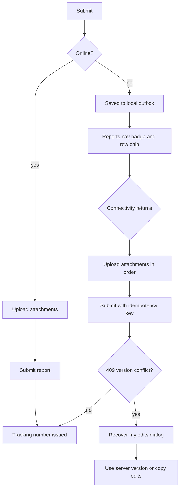

# Phase 15 — Desktop offline and Tauri status

**Milestone:** M7
**Routes:** no new pages; `/reports?tab=drafts` gains outbox behavior, the wizard
and edit page change their submit affordance, and the shell gains status
surfaces
**Depends on:** 05 (reports rows and tabs), 06 (wizard/draft store), 07
(conflict dialog), 08 (print preview)
**Source:** `par-ui-ux-spec.md` §8.6, §7.4 (pending-sync rows), §7.6 (409), §7.8
(print in webview), §12; `apps/web/src/lib/platform/contracts.ts`,
`apps/desktop/README.md`

Desktop is the same SvelteKit bundle in a Tauri 2 Windows shell. Offline
affordances exist **only** in that shell. The web build must never show them.

---

## 1. Context for this run

- The Tauri shell owns connectivity and sync status. Components never call Tauri
  APIs directly; add capabilities to the `Platform` adapters in
  `apps/web/src/lib/platform/` and keep the web fallbacks inert.
- Existing contracts to implement, not replace: `DraftStore`, `SecureTokenStore`,
  `FilePicker`. Extend `Platform` with an outbox/connectivity capability if the
  shell needs to push status; keep one interface for both builds.
- Implement in this phase:
  - `tauri/draft-store.ts` — local SQLite (`sqlite:par-drafts.db`) via the Tauri
    SQL plugin, including queued attachment paths.
  - `tauri/secure-token-store.ts` — OS credential store for the bearer token.
  - `tauri/file-picker.ts` — dialog plugin so uploads stream from disk.
- Verify the web `DraftStore` already uses IndexedDB from phase 06 and survives a
  reload; do not regress it while adding the Tauri adapters.
- No persistent in-page offline banner. The only in-page offline moment is at
  submit.
- Web build: no offline affordances at all; a failed request gets the standard
  error state. Never render "Offline" in web.

---

## 2. Shell-owned status

- **Window title** and **tray tooltip** show the connection state:
  - Online: "OVPCASSS Paperless PAR — Online"
  - Offline: "OVPCASSS Paperless PAR — Offline — 2 reports waiting"
  - The waiting count is the outbox size, not the draft count.
- **Native menu item "Pending uploads"** navigates to `/reports?tab=drafts`.
  The navigation goes through the web app's router, not a new window.
- Status updates are pushed from the Rust shell to the webview; the web app
  subscribes through the platform adapter and exposes a reactive store.
- No toast for a connectivity change. No modal. No banner.
- If the shell cannot determine status, render nothing rather than guessing
  "Online".

---

## 3. Submit while offline

In the wizard (step 4) and the edit-returned page:

- When offline, the primary action label becomes **Save to outbox**.
- On click: save the complete report (fields + attachment references/paths) to
  the outbox, and toast: "Saved on this device. We will send it when you are back
  online."
- The local draft is promoted to a queued report; it is no longer editable as a
  draft unless the user reopens it before sync. If they do, changes update the
  queued payload.
- Generating a tracking number happens on the server at submit; the offline row
  shows `—` until then.
- The outbox entry carries an idempotency key generated at enqueue time so a
  retry cannot create duplicates.
- Required attachments must exist locally; a missing file blocks enqueue with an
  adjacent reason naming the file. Do not queue a report that cannot be sent.
- Server validation cannot run offline. Show an inline note: "Basic checks only;
  the report is validated when it is sent." Run the same client-side checks as
  the wizard.

---

## 4. Queued rows and sync

- Queued reports appear **first** in `/reports` (all tabs where relevant,
  primarily Drafts), with a gold left border and the chip:
  "On this device — waiting to send".
- The Reports nav item shows a count badge for queued reports. The badge is
  separate from queue review counts; label its accessible name "2 reports
  waiting to send".
- Once connectivity returns, sync runs automatically, oldest queued first:
  1. Upload attachments in order; each shows progress.
  2. Submit the report with the idempotency key.
  3. Replace the row chip with "Sending…" (brief), then the issued tracking
     number and `SUBMITTED` status.
- Failures keep the row queued and show an adjacent reason with **Retry**.
  Do not drop the row. A permanent rejection (validation, missing file) marks the
  row "Needs attention" and links to the edit page; it stays visible.
- Conflict (409): open the modal from phase 07 ("This report changed while you
  were offline"), side-by-side server/local, **Use server version** or **Copy my
  edits**. Never merge silently. The queued row remains until resolved.
- Sync events are not toasted on success (no background-sync toast). Failures may
  toast once, plus the row state.

---

## 5. Print preview in the webview

- The print preview from phase 08 must work inside the Tauri webview:
  - `Ctrl+P` invokes the webview print dialog with the same print CSS.
  - Download PDF uses the webview's print-to-PDF path or the server PDF where the
    source specifies it; never produce a blank page.
  - A4/15 mm, letterhead, page-break rules, and watermarks must match the browser
    output (phase 08).
- The toolbar remains visible on screen and hidden in print.
- Verify on Windows WebView2 at 100% and 125% scaling.

---

## 6. States and edge cases

- Web build: platform adapters report no offline support; all offline UI is
  absent. A failed request shows the standard error alert.
- Desktop startup offline: drafts and queued rows load from SQLite; the app is
  usable for drafting and queuing. Sign-in while offline is not supported in v1;
  show the standard sign-in error.
- Token expiry while queued: keep the queue, prompt for sign-in, and resume after
  authentication. Never clear the outbox.
- File moved/deleted after enqueue: block sync, mark "Needs attention", and offer
  re-attach.
- App closed mid-upload: on next launch, queued rows return to "waiting to send";
  already-confirmed attachments are not re-uploaded (use checksums/ids).
- Clock/timezone: outbox ordering uses enqueue time in UTC; display Manila.
- Very large attachment: enforce the 25 MB limit at enqueue, not at sync.

---

## 7. Acceptance checklist

- [ ] Tauri `DraftStore` persists to SQLite and survives app restart; the web
      `DraftStore` remains IndexedDB-backed and survives reload.
- [ ] `SecureTokenStore` uses the OS credential store; the token never appears in
      webview storage.
- [ ] File picker uses the Tauri dialog and streams from disk.
- [ ] Components never import Tauri APIs; platform adapters expose capabilities
      to both builds.
- [ ] Window title and tray tooltip show Online / Offline — N reports waiting, and
      the count reflects the outbox.
- [ ] Native "Pending uploads" navigates to `/reports?tab=drafts`.
- [ ] No persistent offline banner, connectivity toast, or modal exists.
- [ ] Offline submit changes the label to Save to outbox and shows the exact toast
      copy.
- [ ] Queued rows appear first with the gold border/chip; the Reports nav shows a
      separate waiting count with an accessible name.
- [ ] Reconnect syncs oldest first, uploads attachments in order, shows Sending…,
      then issues a tracking number; retries cannot duplicate reports.
- [ ] 409 opens the phase 07 conflict modal and never auto-merges.
- [ ] Permanent failures mark "Needs attention" and link to edit; rows are never
      silently dropped.
- [ ] Web build shows none of the offline affordances and uses standard error
      states.
- [ ] Print preview works in the WebView2 with A4/15 mm, letterhead, page breaks,
      footer, and watermarks.
- [ ] Desktop verification was performed on Windows (state the WebView2 version
      and scaling); any unverified item is reported as not verified.

## 8. Out of scope

- macOS/Linux builds.
- Offline sign-in, offline review/approval decisions, and offline admin actions.
- Background sync while the app is closed.
- Multi-device draft conflict resolution; the outbox is per device.
- Auto-update, installers, and code signing.

## 9. Open questions

1. What is the outbox retry policy (manual only vs. backoff)? This spec requires
   manual Retry plus automatic one-shot on reconnect.
2. Should a queued report be editable after enqueue? This spec allows edits until
   sync starts, with the payload updated.
3. Does "Pending uploads" include draft files that were never queued? Assumed no
   — the menu item points at the drafts tab, but the count is outbox-only.
4. Confirm print-to-PDF in WebView2 meets the A4/letterhead fidelity requirement,
   or whether all PDF downloads should come from the server.

---

## Appendix — offline sync journey

